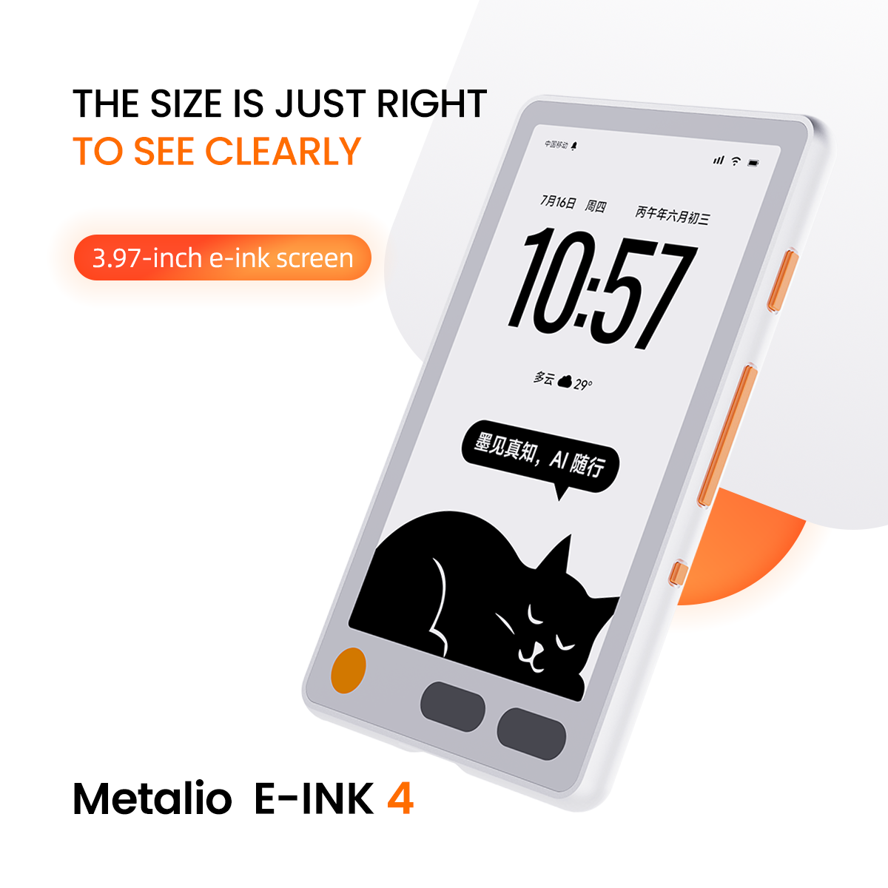
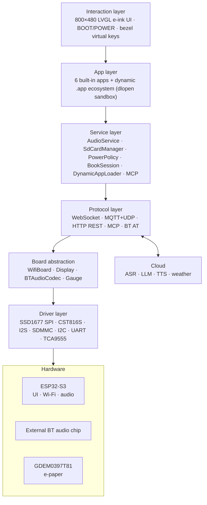

# Metalio E-Ink 4

<p align="center">
  
</p>

[中文](README_zn.md) | **English**

An installable e-ink device: 3.97″ e-paper + touch + voice AI + local library, plus a **flash-free dynamic app ecosystem** — 6 built-in system apps on firmware, 30+ dynamic apps on the SD card (board games, puzzles, reading, tools, identity cards…), installed/uninstalled through the on-device **App Store**.

**Quick links**

- ESP-IDF docs: [ESP32-S3 Get Started v5.5.4](https://docs.espressif.com/projects/esp-idf/en/v5.5.4/esp32s3/get-started/index.html)

---

## Contents

1. [Feature highlights](#1-feature-highlights)
2. [App catalog](#2-app-catalog)
3. [App store & dynamic app mechanism](#3-app-store--dynamic-app-mechanism)
4. [System architecture](#4-system-architecture)
5. [Hardware specs](#5-hardware-specs)
6. [Peripherals and pins](#6-peripherals-and-pins)
7. [Software architecture & partitions](#7-software-architecture--partitions)
8. [Protocols](#8-protocols)
9. [Development environment](#9-development-environment)
10. [Build and flash](#10-build-and-flash)
11. [Remote debugging & REST API](#11-remote-debugging--rest-api)
12. [FAQ](#12-faq)
13. [Docs index](#13-docs-index)

> Per-app documentation pages (`docs/app-<id>.md`) are written in Chinese and include real-device screenshots.

---

## 1. Feature highlights

### 1.1 AI voice chat

Hold-to-talk → streaming ASR → LLM → TTS playback, fully cloud-streamed; adjustable voice / speed / emotion; conversation logs on SD.

<p>
  
  
  
</p>

### 1.2 E-paper reading

`.ebook` / `.epub` / `.txt` library with a reading-stats home page and continue-reading card; TOC, font size / family, margins adjustable; PC-side conversion toolchain with web preview. Lists and reader **never scroll** — paging instead of dragging is the e-ink way.

### 1.3 Dynamic app ecosystem (30+ on device)

Board games, logic puzzles, casual games, poetry & knowledge cards, identity cards, system tools… all installed **without reflashing**: drop a bundle on the SD card, push over Wi-Fi, or upload a ZIP. Full app catalog in [§2](#2-app-catalog).

### 1.4 App store

The built-in App Store scans SD app bundles, one-tap install / uninstall (data preserved on uninstall); new pushes appear on the desktop automatically. See [§3](#3-app-store--dynamic-app-mechanism) and [`docs/app-store.md`](docs/app-store.md).

### 1.5 Cloud & transfer

- **Wi-Fi web transfer**: scan a QR code, upload books (auto-registered into the library) and wallpapers, full-disk file management
- **Web OTA flashing**: upload a `.bin` from the browser to upgrade firmware
- **Remote REST / MCP**: screenshot, click, install apps, query state — scriptable end to end (see [§11](#11-remote-debugging--rest-api))

### 1.6 Low power & always-on

- Single-cell Li-ion + BQ27220 gauge; auto light-sleep standby, cumulative auto power-off (configurable)
- E-paper **keeps the image without power**: standby wallpaper, shutdown image, parking phone-number board, badge — all "refresh once, hang all day" scenarios
- PCF8563 hardware RTC survives reboots

---

## 2. App catalog

Each app has its own doc page (real-device screenshot + gameplay + data + e-ink design notes) — see the Chinese README for the full linked table: [`README_zn.md` §2](README_zn.md#2-应用全景). Summary:

| Group | Apps |
|:---|:---|
| **Built-in system** | Home desktop, Reading (book), AI chat, App store, System upgrade, Power, Settings |
| **Content & reading** | WeChat Read (QR login / cloud shelf / decrypt / e-ink typography), Knowledge cards (44k-card offline wiki), Tang/Song poetry (1092 poems + 41 essays), Weather (353 cities + TTS), Internet radio, Calendar |
| **Board games** | Gomoku (3-level AI), Chinese chess (full rules + checkmate), Peg solitaire (33-hole English board) |
| **Logic puzzles** | Sudoku (unique-solution generator), Minesweeper, Nonogram (10 pictures), Slitherlink (procedural levels) |
| **Casual games** | 2048, Tetris (hold/ghost/wall-kick), Sokoban (guaranteed-solvable levels), Klondike solitaire, Memory flip, Conway's Game of Life |
| **Fun & lifestyle** | Pomodoro, Night-market divination (text adventure), Liu-yao hexagrams, QR business card, E-badge, Payment QR stand, Parking phone board |
| **System tools** | Wi-Fi transfer, Backup & restore, Standby wallpaper, Time sync, System info, GLM usage, Hello (dev template) |

<p align="center">
  
  
  
  
</p>

---

## 3. App store & dynamic app mechanism

A macOS-style application bundle architecture with sandbox isolation: **compile once, install anywhere, run on tap, unload on exit**. Full mechanism in [`docs/app-store.md`](docs/app-store.md); dev spec in [`docs/dynamic-apps.md`](docs/dynamic-apps.md).

### 3.1 App bundle

Each app is a directory on the SD card — a manifest declares identity, `lib/app.so` is the ELF dynamic library:

```text
/sdcard/metalio/e-ink/apps/<AppName>.app/
├── manifest.json   metadata: id / name / version / abi gate
├── icon.png        70×70 monochrome icon
├── lib/app.so      code (dlopen into PSRAM)
├── resources/      read-only static assets
└── data/           app-private sandbox — never overwritten on reinstall/upgrade
```

### 3.2 Key mechanisms

- **Lazy loading**: only a few dozen bytes of manifest registration at rest; `dlopen` on open; `dlclose` frees PSRAM on exit
- **Sandbox**: an app may only write its own `data/`; path traversal rejected; NVS forbidden — all config is JSON files
- **ABI gate**: mismatched `abi` is blocked at scan time, never loaded
- **Install state**: NVS flag defaults to installed — pushing a bundle into `apps/` auto-registers it on the desktop

### 3.3 Five install channels

| Channel | Scenario |
|:---|:---|
| SD card / virtual USB disk copy | No network |
| `POST /fs/upload` direct file push | Scripted single-file update |
| `POST /app/install` ZIP one-shot install (≤64MB) | Full bundle distribution |
| MCP tools `self.app.install/list/uninstall/enable/disable` | AI-agent orchestration |
| `./tools/package_app.sh tools/<app> --upload <IP> --pin <PIN>` | Dev hot-deploy |

The on-device App Store handles browsing / installing / uninstalling: 5 bundles per page, capsule buttons toggling install state, paging via gesture or bezel keys. Uninstall only deregisters the desktop entry — bundle files and `data/` stay, reinstall anytime.

### 3.4 What dynamic apps can call

The firmware symbol table exports: LVGL 9 graphics, libc, sandbox file APIs, status-bar / bezel-key bridges, vector font packs, e-ink partial/full refresh control, and **cloud capabilities** — TTS (`dynapp_tts_speak`), certificate-backed async HTTPS (`dynapp_http_get_async`), memory pre-check (`dynapp_sysinfo_get`), zlib inflate (`dynapp_zlib_inflate`). Weather, radio and GLM usage apps are all built on these.

Build your own: copy the `tools/hello_app` template → edit the manifest → `./tools/package_app.sh tools/my_app --upload <IP> --pin <PIN>` → it appears on the desktop.

---

## 4. System architecture



Voice data flow: PTT hold → I2S mic → AudioService encode → WebSocket/MQTT → cloud ASR → LLM → TTS playback + reply text rendered on screen.

---

## 5. Hardware specs

| Item | Spec |
|:---|:---|
| **MCU** | ESP32-S3 (Xtensa LX7); Flash 16 MB; Octal PSRAM @ 80 MHz |
| **Display** | GDEM0397T81, 3.97″, 800×480, SPI SSD1677; **1bpp monochrome, partial + full refresh, Bayer-dither gray** |
| **Touch** | CST816S (I2C 0x15) + cover-glass virtual keys HOME / PREV / NEXT (Y=900 off-glass zone) |
| **Audio** | External BT audio chip (UART AT) + I2S mic/speaker, 16 kHz |
| **Storage** | Onboard Flash (dual OTA slots) + microSD (SDMMC 1-bit) |
| **Sensors** | SC7A20H accelerometer, PCF8563 RTC, BQ27220 fuel gauge, CX25601N charger |
| **Power** | Single-cell Li-ion, 500 mA charging; idle 3 min → light-sleep standby, cumulative auto power-off (configurable) |
| **Misc** | Vibration motor, USB camera/flash path mux (FSUSB42UMX), virtual USB disk (USB MSC, exclusive with flashing) |

---

## 6. Peripherals and pins

Pin map: `main/boards/metalio-e-ink-4/config.h`; IO expander: `main/boards/common/IOExpander.hpp`

### 6.1 ESP32-S3 direct GPIO (key items)

| Function | GPIO | Function | GPIO |
|:---|:---:|:---|:---:|
| I2C SDA / SCL | 41 / 42 | EPD SPI (MOSI/SCLK/CS/DC/RST/BUSY) | 8 / 14 / 45 / 13 / 18 / 9 |
| I2S mic (WS/DIN) | 43 / 17 | SDMMC (CLK/CMD/D0/DAT3) | 38 / 40 / 39 / 46 |
| I2S spk (BCLK/DOUT) | 6 / 7 | USB DM/DP (via FSUSB42UMX) | 19 / 20 |
| BT audio UART (TX/RX) | 48 / 47 | Touch INT / IO-expander INT | 1 / 2 |
| BOOT / POWER | 0 / 3 | Vibration motor | 44 |

### 6.2 TCA9555 IO expander (I2C 0x20)

| Pin | Function | Pin | Function |
|:---|:---|:---|:---|
| P0.0 | USB_MUX_SEL (low=camera, high=flash) | P1.0 | Volume + (active low) |
| P0.1 | PA_SWITCH amp source | P1.1 | Touch RST (active low) |
| P0.4 | PA amp enable | P1.3 | PWR_KEY_PULSE soft power-off |
| P0.5 | Screen socket power | P1.4 | Accelerometer INT |
| P0.6 | MAIN_PWR main rail | P0.7 | Volume − (active low) |

### 6.3 I2C addresses

TCA9555 `0x20` · CST816S `0x15` · PCF8563 `0x51` · BQ27220 `0x55` · CX25601N `0x6B` · SC7A20H `0x19`

---

## 7. Software architecture & partitions

Firmware is based on [xiaozhi-esp32](https://github.com/78/xiaozhi-esp32), customized for the `metalio-e-ink-4` board.

| Layer | Path | Role |
|:---|:---|:---|
| Entry | `main.cc` → `Application` | Boot, event loop, state machine |
| Board | `main/boards/metalio-e-ink-4/` | HW init, pins, EPD/touch |
| Display | `main/display/screen/*`, `display/a2ui/` | Built-in apps, e-ink flushing, status bar |
| Dynamic apps | `main/services/dynamic_apps/` | Scanner, elf loader, sandbox shims, symbol table, cloud caps |
| Reading | `main/reader/`, `tools/ebook/` | Book session, `.ebook` toolchain |
| Audio / protocols | `main/audio/`, `main/protocols/` | Codecs, WebSocket / MQTT+UDP |
| Power | `main/boards/common/power_policy/` | Profiles, standby, power-off |

Flash partitions (`partitions/v1/16m.csv`): `nvs` 16K / `model` 400K / **`ota_0` + `ota_1` 5MB each** / `resources` 400K / **`font_data` 5MB** (UI vector fontpack, mmap; poetry glyph supplements live here too) / `coredump` 64K.

SD layout (root `/sdcard/metalio/e-ink/`): `books/` · `fonts/` · `wallpaper/` · `apps/` (**app bundles**) · `backup/` · `radio/` · `firmware/` · `chat_log/`.

---

## 8. Protocols

| Protocol | Purpose |
|:---|:---|
| **WebSocket / MQTT+UDP** | Streaming voice chat (ASR/LLM/TTS) |
| **MCP** | Device capabilities for LLMs (`http://<IP>:8080/mcp`, PIN auth) |
| **HTTP REST** | File push, app install, screenshot, input injection, OTA (see [§11](#11-remote-debugging--rest-api)) |
| **BT AT** | External BT audio module: mode 1 chat (default) / mode 2 transmit & pair / mode 3 speaker, via UART2 115200 |
| **Open-Meteo / BigModel etc.** | Dynamic apps call third-party APIs via `dynapp_http_get_async` |

---

## 9. Development environment

| Item | Requirement |
|:---|:---|
| **ESP-IDF** | **v5.5.4** (must match repo `sdkconfig`) |
| **Target** | ESP32-S3 (preconfigured) |
| **OS** | Linux / macOS / Windows (WSL2 recommended) |

```bash
# After installing ESP-IDF v5.5.4:
git clone <your-repo-url> && cd Metalio-E-INK4
. ~/esp/v5.5.4/export.sh
idf.py build
```

> **Do not tweak `sdkconfig` unnecessarily** — it is tuned for e-paper, PSRAM and partitions.

---

## 10. Build and flash

```bash
idf.py -p /dev/ttyACM0 flash monitor     # flash + monitor (adjust port)

./merge_firmware.sh                       # merge full firmware (incl. font_data)
# produces firmware/metalio-e-ink4-<ver>.bin and metalio-e-ink-4.bin
```

- While the **virtual USB disk** is enabled, Serial/JTAG is unavailable (shared GPIO19/20) — disable it before flashing
- **SD card**: FAT32; put assets under `metalio/e-ink/...`
- **Dynamic app packaging**: `./tools/package_app.sh tools/<app> [--upload <IP> --pin <PIN>]`
- **E-book conversion**: `tools/ebook/` (PDF/EPUB/MOBI/TXT → `.ebook`, see [`tools/ebook/README.md`](tools/ebook/README.md))

---

## 11. Remote debugging & REST API

The device serves `http://<IP>:8080` with `Authorization: Bearer <PIN>` (see Settings → MCP to view/regenerate; IP in Settings → Network or boot serial log).

| Endpoint | Purpose |
|:---|:---|
| `GET /screen/screenshot` | Current screen as BMP |
| `POST /app/launch?id=<id>` | Launch an app |
| `POST /screen/home` · `/input/key` · `/input/click` | Go home / inject key / inject tap |
| `POST /fs/upload` · `/fs/delete` · `GET /fs/list` | SD file push / delete / browse |
| `POST /app/install` | One-shot ZIP app install |
| `POST /system/ota` · `/system/reboot` · `/system/sleep` | Remote OTA / reboot / standby |

Helper scripts: `tools/screenshot.sh` (screenshot → PNG), `tools/click.sh` (tap injection). The 38 real-device screenshots in `docs/screenshots/` were batch-produced by a launch → capture loop.

> **Note**: while the device is in standby its network is down and remote endpoints are unreachable — **not a crash**; press the physical power key to wake.

MCP tools for AI agents: `self.app.*` (app management), `self.aichat.configure`, `self.glm_usage.configure`, `self.calendar.*`, `self.input.click`, and more.

---

## 12. FAQ

**Q: ESP-IDF version mismatch at build** — use v5.5.4 and source `export.sh` first.

**Q: Screen not refreshing / artifacts** — verify `sdkconfig` and board display params untouched; check TCA9555 P0.5 (screen power) / P0.6 (main rail).

**Q: Touch unresponsive** — possibly standby (short-press POWER to wake); check touch RST (P1.1) and INT (GPIO1).

**Q: Port 8080 unreachable** — standby takes the network down by design; wake physically. Check IP and PIN. Plugged-in devices keep the network alive.

**Q: SD mount failure** — FAT32; SDMMC 1-bit; DAT3 (GPIO46) must stay pulled high.

**Q: Cannot flash after using virtual USB disk** — disable MSC / eject safely to restore Serial/JTAG.

**Q: Battery % jumps / charging oddities** — see [`docs/battery-soc-and-charge.md`](docs/battery-soc-and-charge.md); UI SOC is voltage-estimated.

**Q: Dynamic app crash / load failure** — see the pitfall list in [`docs/dynamic-apps.md`](docs/dynamic-apps.md) (unexported symbols, GOT relocation, newlib NANO printf…); grab `dlerror` logs from serial.

---

## 13. Docs index

| Doc | Content |
|:---|:---|
| [`docs/app-store.md`](docs/app-store.md) | **App store & dynamic app mechanism** (bundle, sandbox, install channels, lifecycle) |
| [`docs/dynamic-apps.md`](docs/dynamic-apps.md) | Dynamic app dev spec (sandbox APIs, cloud caps, packaging, pitfalls) |
| [`docs/app-<id>.md`](docs/app-knowledge.md) | Per-app pages, 38 of them (real-device screenshots) |
| [`docs/battery-soc-and-charge.md`](docs/battery-soc-and-charge.md) | Battery SOC & charging |
| [`docs/epd-bayer-dither-gray.md`](docs/epd-bayer-dither-gray.md) | E-ink Bayer dither gray |
| [`docs/system-operation-and-debugging-guide.md`](docs/system-operation-and-debugging-guide.md) | Operation & debugging guide |
| [`docs/unified-navigation-and-automation.md`](docs/unified-navigation-and-automation.md) | Unified navigation & automation |
| [`tools/ebook/README.md`](tools/ebook/README.md) | E-book conversion toolchain |
| [`tools/fontpack/`](tools/fontpack/) · [`tools/epdfont/`](tools/epdfont/) | UI fontpack / reader font tools |

---

*This document evolves with the firmware. Source code is the source of truth for pins and behavior; if anything disagrees with the hardware, please open an issue.*
