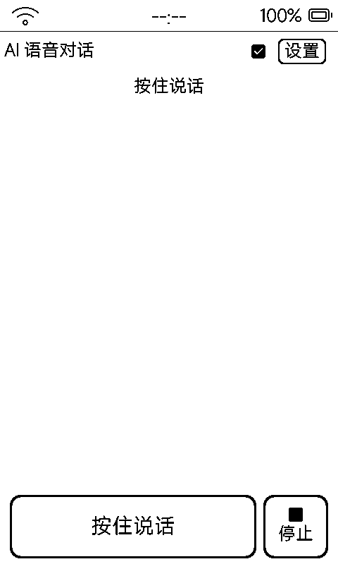
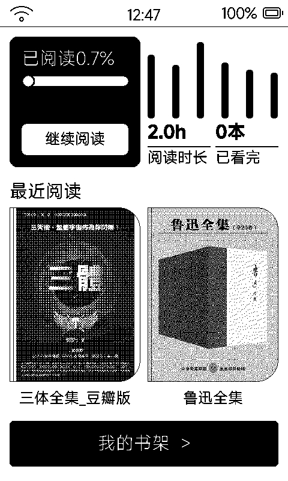
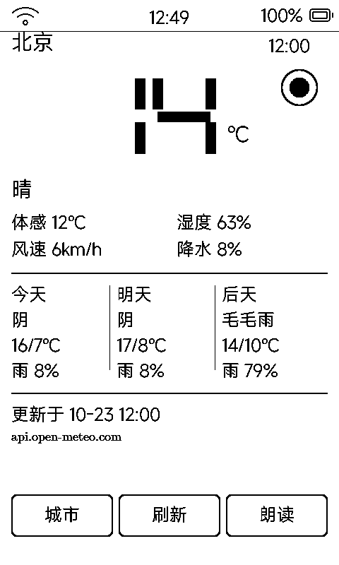
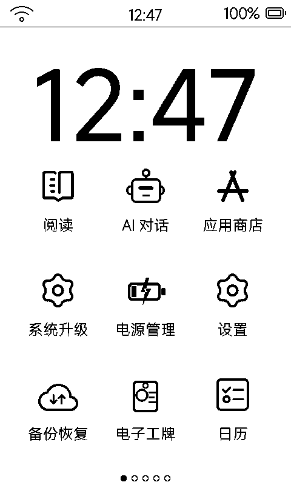
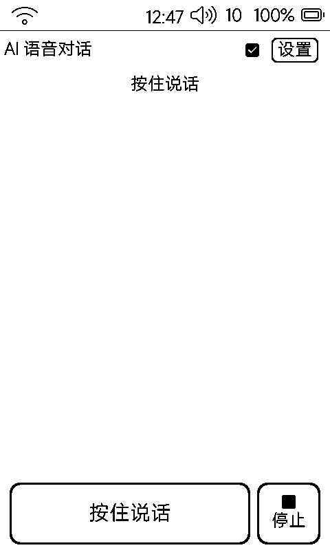
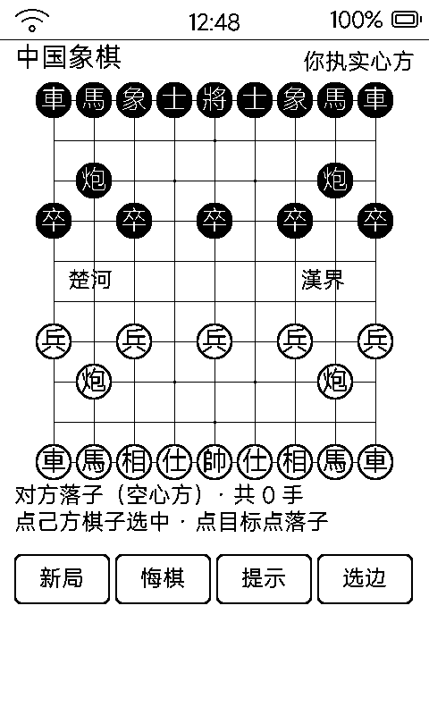
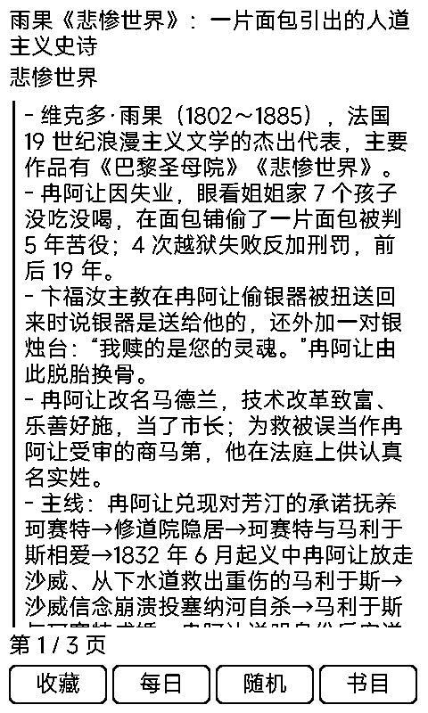
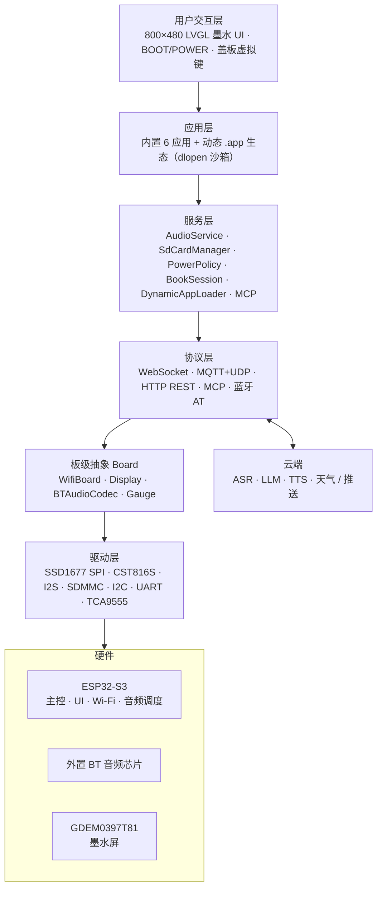

# Metalio E-Ink 4

<p align="center">
  
</p>

**中文** | [English](README.md)

一台能装应用的墨水屏：3.97″ 电子纸 + 触控 + 语音 AI + 本地书库，以及一套**免刷机的动态应用生态**——内置 6 个系统应用，SD 卡上再装 30+ 个动态应用（棋类、解谜、阅读、工具、身份卡……），通过设备上的**应用商店**一键安装卸载。

**快速链接**

- ESP-IDF 官方文档：[ESP32-S3 快速入门 v5.5.4](https://docs.espressif.com/projects/esp-idf/zh_CN/v5.5.4/esp32s3/get-started/index.html)

---

## 目录

1. [功能亮点](#1-功能亮点)
2. [应用全景](#2-应用全景)
3. [应用商店与动态应用机制](#3-应用商店与动态应用机制)
4. [系统架构](#4-系统架构)
5. [硬件规格](#5-硬件规格)
6. [外设与引脚](#6-外设与引脚)
7. [软件架构与分区](#7-软件架构与分区)
8. [通信协议](#8-通信协议)
9. [开发环境](#9-开发环境)
10. [编译与烧录](#10-编译与烧录)
11. [远程调试与 REST API](#11-远程调试与-rest-api)
12. [常见问题](#12-常见问题)
13. [文档索引](#13-文档索引)

---

## 1. 功能亮点

### 1.1 AI 语音对话

按住说话 → 流式 ASR → LLM → TTS 播报，全链路上云；音色 / 语速 / 情绪可调，对话记录落 SD。

<p>
  
  
  
</p>

### 1.2 墨水屏阅读

`.ebook` / `.epub` / `.txt` 三格式书库，阅读统计首页 + 继续阅读；章节目录、字号字体、页边距可调；PC 侧工具链一键转换（含 Web 预览）。列表与正文**禁止滚动**，翻页代替滑动——墨水屏不留残影的正确姿势。

### 1.3 动态应用生态（本机 30+ 个）

棋类对战、逻辑解谜、休闲游戏、诗词卡片、身份卡片、系统工具……全部**免刷机安装**：SD 卡放包、WiFi 推送、ZIP 上传皆可，点开即玩、退出即释放内存。逐个应用的介绍见 [§2 应用全景](#2-应用全景)。

### 1.4 应用商店

设备上内置「应用商店」：自动扫描 SD 卡应用包，一键安装 / 卸载（卸载保留数据），新包推入自动上桌面。机制详解见 [§3](#3-应用商店与动态应用机制) 与 [`docs/app-store.md`](docs/app-store.md)。

### 1.5 云与传输

- **WiFi 网页传输**：手机扫码直达，传书直存图书库、传图即成壁纸，全盘文件管理
- **网页无线刷机**：扫码上传 `.bin` OTA 升级固件
- **远程 REST / MCP**：截图、点击、装应用、查状态全有 HTTP 端点，AI 代理可直接编排（见 [§11](#11-远程调试与-rest-api)）

### 1.6 低功耗与常显

- 单节锂电 + BQ27220 电量计；空闲自动进浅睡待机，累计自动关机（时长可调）
- 墨水屏**断电不丢画面**：待机壁纸、关机图、挪车电话牌、电子工牌都是「刷一次挂一天」的常显场景
- PCF8563 硬件 RTC 掉电保持，重启不丢时

---

## 2. 应用全景

每个应用都有独立文档页（真机截图 + 玩法 + 数据 + 墨水屏设计细节），点链接进入。

### 内置系统应用（固件自带，不可卸载）

| 应用 | 一句话 | 文档 |
|:---|:---|:---|
| **桌面** | 大时钟 + 农历天气 + 3×3 应用宫格，手势 / 虚拟键翻页 | [`docs/app-home.md`](docs/app-home.md) |
| **阅读** | 书库 + 阅读统计 + 排版设置，`.ebook/.epub/.txt` | [`docs/app-book.md`](docs/app-book.md) |
| **AI 对话** | 按住说话，流式 ASR / LLM / TTS | [`docs/app-aichat.md`](docs/app-aichat.md) |
| **应用商店** | SD 应用包扫描、一键安装 / 卸载 | [`docs/app-store.md`](docs/app-store.md) |
| **系统升级** | WiFi 网页 OTA + SD 卡 `.bin` 双通道 | [`docs/app-upgrade.md`](docs/app-upgrade.md) |
| **电源管理** | 息屏待机 / 重启 / 关机 | [`docs/app-power.md`](docs/app-power.md) |
| **设置** | 网络、主题、功耗、存储（虚拟 U 盘）、蓝牙、MCP PIN | [`docs/app-set.md`](docs/app-set.md) |

### 内容与阅读

| 应用 | 一句话 | 文档 |
|:---|:---|:---|
| **微信读书** | 微信扫码登录、云端书架同步、分片解密与墨水屏精致排版 | [`docs/app-weread.md`](docs/app-weread.md) |
| **知识卡片** | 4.4 万卡个人知识库，`[[链接]]` 跳转，每日一卡 | [`docs/app-knowledge.md`](docs/app-knowledge.md) |
| **唐诗宋词** | 1092 首 + 41 篇赏析，每日一诗、收藏夹、书目 | [`docs/app-poems.md`](docs/app-poems.md) |
| **天气** | 七段数码管大温度 + 三天预报 + TTS 朗读，353 城 | [`docs/app-weather.md`](docs/app-weather.md) |
| **收音机** | 网络电台直播流，电台清单全自定义 | [`docs/app-radio.md`](docs/app-radio.md) |
| **日历** | 月历日程，打通 AI 待办与 ICS 订阅 | [`docs/app-cal.md`](docs/app-cal.md) |

### 棋类对战

| 应用 | 一句话 | 文档 |
|:---|:---|:---|
| **五子棋** | 人机三档 AI / 双人同机，悔棋续盘 | [`docs/app-gomoku.md`](docs/app-gomoku.md) |
| **中国象棋** | 完整走法 + 将死判定，空心 / 实心分阵营 | [`docs/app-xq.md`](docs/app-xq.md) |
| **孔明棋** | 英文十字盘 33 洞独粒钻石，纯几何棋面 | [`docs/app-peg.md`](docs/app-peg.md) |

### 逻辑解谜

| 应用 | 一句话 | 文档 |
|:---|:---|:---|
| **数独** | 程序生成保证唯一解，四档难度 | [`docs/app-sudoku.md`](docs/app-sudoku.md) |
| **扫雷** | 三档雷数，长按插旗，chord 连开 | [`docs/app-minesweeper.md`](docs/app-minesweeper.md) |
| **数织** | 10 幅内置图案，按行列提示还原图形 | [`docs/app-non.md`](docs/app-non.md) |
| **数回** | Slitherlink 闭合回路，关卡程序生成无限供应 | [`docs/app-slink.md`](docs/app-slink.md) |

### 休闲游戏

| 应用 | 一句话 | 文档 |
|:---|:---|:---|
| **2048** | 滑动合并，单步悔棋，灰阶编码分层 | [`docs/app-game2048.md`](docs/app-game2048.md) |
| **方块战争** | 完整规则俄罗斯方块：hold / ghost / 踢墙 | [`docs/app-tetris.md`](docs/app-tetris.md) |
| **推箱子** | 关卡逆向生成保证有解，可爱小人 + 网点灰 | [`docs/app-sok.md`](docs/app-sok.md) |
| **纸牌接龙** | Klondike，明暗分花色，网点灰牌背 | [`docs/app-sol.md`](docs/app-sol.md) |
| **记忆翻牌** | 翻牌配对，6 对 / 8 对 | [`docs/app-mem.md`](docs/app-mem.md) |
| **生命游戏** | 康威演化，点格编辑 + 预设 + 自动播放 | [`docs/app-life.md`](docs/app-life.md) |

### 趣味与生活

| 应用 | 一句话 | 文档 |
|:---|:---|:---|
| **番茄钟** | 七段数码管 + 排水条，断电计时照走 + 7 天统计 | [`docs/app-pomo.md`](docs/app-pomo.md) |
| **夜市卜卦** | 20 晚 20 客抉择式文字冒险，三断法博弈 | [`docs/app-ntbk.md`](docs/app-ntbk.md) |
| **六爻占卜** | 逐爻摇卦，65 卦本卦变卦断语 | [`docs/app-liuyao.md`](docs/app-liuyao.md) |
| **电子名片** | 递出去的名片：身份区 + 多码标签切换 | [`docs/app-qrcard.md`](docs/app-qrcard.md) |
| **电子工牌** | 挂胸前的身份卡：大头像大字，多页轮播 | [`docs/app-badge.md`](docs/app-badge.md) |
| **收款码** | 微信 / 支付宝码摆台面，点码全屏 | [`docs/app-paycode.md`](docs/app-paycode.md) |
| **挪车电话** | 160px 大号码牌，一键生成待机壁纸 | [`docs/app-parking.md`](docs/app-parking.md) |

### 系统工具

| 应用 | 一句话 | 文档 |
|:---|:---|:---|
| **WiFi 传输** | 扫码网页传书 / 传图 / 全盘管理 | [`docs/app-wififile.md`](docs/app-wififile.md) |
| **备份恢复** | 系统配置 / 应用数据 / 应用包三层快照 | [`docs/app-backup.md`](docs/app-backup.md) |
| **待机壁纸** | 壁纸挑选与待机 / 关机设置 | [`docs/app-wallpaper.md`](docs/app-wallpaper.md) |
| **时间校准** | SNTP 对时 + 手动校准硬件 RTC | [`docs/app-time.md`](docs/app-time.md) |
| **系统信息** | 内存 / 存储 / NVS / 硬件仪表 | [`docs/app-info.md`](docs/app-info.md) |
| **GLM 用量** | 智谱 API 套餐额度监控 | [`docs/app-glm.md`](docs/app-glm.md) |
| **Hello** | 动态应用开发模板（开发者起点） | [`docs/app-hello.md`](docs/app-hello.md) |

<p align="center">
  
  
  
  
</p>

---

## 3. 应用商店与动态应用机制

借鉴 macOS Application Bundle 的应用包架构 + 沙箱隔离，核心是**「一次编译、随处安装、即点即用、退出即卸」**。完整机制见 [`docs/app-store.md`](docs/app-store.md)，开发规范见 [`docs/dynamic-apps.md`](docs/dynamic-apps.md)。

### 3.1 应用包

每个应用是 SD 卡上一个目录，manifest 声明身份，`lib/app.so` 是 ELF 动态库：

```text
/sdcard/metalio/e-ink/apps/<AppName>.app/
├── manifest.json   元数据：id / name / version / abi 闸门
├── icon.png        70×70 黑白图标
├── lib/app.so      代码（dlopen 载入 PSRAM）
├── resources/      只读静态资源
└── data/           应用私有沙箱——重装 / 升级绝不覆盖
```

### 3.2 关键机制

- **惰性加载**：平时只占数十字节 manifest 登记；点开才 `dlopen` 进 PSRAM；退回桌面 `dlclose` 彻底释放
- **沙箱隔离**：应用只能写自己的 `data/`，禁止路径穿越；禁止 NVS，配置全部 JSON 文件化
- **ABI 闸门**：manifest 的 `abi` 不匹配固件就直接拦截提示，不带病加载
- **安装态**：NVS 标志缺省 = 已安装——推包进 `apps/` 桌面自动出现

### 3.3 五条安装渠道

| 渠道 | 场景 |
|:---|:---|
| 拔卡 / 虚拟 U 盘拷贝 | 无网络环境 |
| `POST /fs/upload` 文件直传 | 脚本更新单个文件 |
| `POST /app/install` ZIP 一键安装（≤64MB） | 完整包分发 |
| MCP 工具 `self.app.install/list/uninstall/enable/disable` | AI 代理远程编排 |
| `./tools/package_app.sh tools/<app> --upload <IP> --pin <PIN>` | 开发热部署一条龙 |

设备上的「应用商店」则负责**浏览 / 安装 / 卸载**：每页 5 个包、胶囊按钮切换安装态、翻页支持手势与盖板键；卸载只注销桌面入口，文件与 `data/` 数据全部保留，随时装回。

### 3.4 动态应用能调用什么

固件符号表显式导出：LVGL 9 图形、libc、沙箱文件 API、状态栏 / 虚拟键桥、矢量字库、墨水屏局刷 / 全刷控制，以及**云能力**——TTS 朗读（`dynapp_tts_speak`）、带证书链的异步 HTTPS（`dynapp_http_get_async`）、内存预检（`dynapp_sysinfo_get`）、zlib 解压（`dynapp_zlib_inflate`）。天气、收音机、GLM 用量等联网应用全部基于这几个口子实现。

自己做一个应用：拷 `tools/hello_app` 模板 → 改 manifest → `./tools/package_app.sh tools/my_app --upload <IP> --pin <PIN>` → 桌面见。

---

## 4. 系统架构



AI 语音数据流：PTT 按住 → I2S 麦克风 → AudioService 编码 → WebSocket/MQTT → 云端 ASR → LLM → TTS 回放 + 回复文本上屏。

---

## 5. 硬件规格

| 类别 | 规格 |
|:---|:---|
| **主控** | ESP32-S3（Xtensa LX7）；Flash 16 MB；Octal PSRAM @ 80 MHz |
| **屏幕** | GDEM0397T81，3.97″，800×480，SPI SSD1677；**1bpp 黑白，局刷 + 全刷，Bayer 网点模拟灰度** |
| **触控** | CST816S（I2C 0x15）+ 盖板虚拟键 HOME / PREV / NEXT（Y=900 盖板外区） |
| **音频** | 外置蓝牙音频芯片（UART AT）+ I2S Mic/Spk，16 kHz |
| **存储** | 板载 Flash（双 OTA 分区）+ microSD（SDMMC 1-bit） |
| **传感器** | SC7A20H 加速度计、PCF8563 RTC、BQ27220 电量计、CX25601N 充电 IC |
| **电源** | 单节锂电，充电 500 mA；空闲 3 分钟进浅睡待机、累计自动关机（可调） |
| **其它** | 震动马达、USB 摄像头 / 烧录通路切换（FSUSB42UMX）、虚拟 U 盘（USB MSC，与烧录互斥） |

---

## 6. 外设与引脚

引脚定义：`main/boards/metalio-e-ink-4/config.h`；IO 扩展映射：`main/boards/common/IOExpander.hpp`

### 6.1 ESP32-S3 直接 GPIO（关键项）

| 功能 | GPIO | 功能 | GPIO |
|:---|:---:|:---|:---:|
| I2C SDA / SCL | 41 / 42 | EPD SPI（MOSI/SCLK/CS/DC/RST/BUSY） | 8 / 14 / 45 / 13 / 18 / 9 |
| I2S Mic（WS/DIN） | 43 / 17 | SDMMC（CLK/CMD/D0/DAT3） | 38 / 40 / 39 / 46 |
| I2S Spk（BCLK/DOUT） | 6 / 7 | USB DM/DP（经 FSUSB42UMX） | 19 / 20 |
| BT 音频 UART（TX/RX） | 48 / 47 | 触摸 INT / IO 扩展 INT | 1 / 2 |
| BOOT / POWER | 0 / 3 | 震动马达 | 44 |

### 6.2 TCA9555 IO 扩展器（I2C 0x20）

| 引脚 | 功能 | 引脚 | 功能 |
|:---|:---|:---|:---|
| P0.0 | USB_MUX_SEL（低=摄像头 高=烧录） | P1.0 | 音量 +（低有效） |
| P0.1 | PA_SWITCH 功放音源 | P1.1 | 触摸 RST（低有效） |
| P0.4 | PA 功放使能 | P1.3 | PWR_KEY_PULSE 软关机脉冲 |
| P0.5 | 屏幕卡座供电 | P1.4 | 加速度计中断 |
| P0.6 | MAIN_PWR 总电源 | P0.7 | 音量 −（低有效） |

### 6.3 I2C 地址表

TCA9555 `0x20` · CST816S `0x15` · PCF8563 `0x51` · BQ27220 `0x55` · CX25601N `0x6B` · SC7A20H `0x19`

---

## 7. 软件架构与分区

固件基于 [xiaozhi-esp32](https://github.com/78/xiaozhi-esp32) 架构，为 `metalio-e-ink-4` 板级定制。

| 层级 | 目录 | 职责 |
|:---|:---|:---|
| 入口 | `main.cc` → `Application` | 启动、事件循环、状态机 |
| 板级 | `main/boards/metalio-e-ink-4/` | 硬件初始化、引脚、EPD/触控 |
| 显示 | `main/display/screen/*`、`display/a2ui/` | 内置应用、墨水刷屏、状态栏 |
| 动态应用 | `main/services/dynamic_apps/` | 扫描器、elf 加载器、沙箱 shim、符号表、云能力 |
| 阅读 | `main/reader/`、`tools/ebook/` | 书会话、`.ebook` 工具链 |
| 音频 / 协议 | `main/audio/`、`main/protocols/` | 编解码、WebSocket / MQTT+UDP |
| 电源 | `main/boards/common/power_policy/` | 档位、待机、关机 |

Flash 分区（`partitions/v1/16m.csv`）：`nvs` 16K / `model` 400K / **`ota_0` + `ota_1` 各 5MB** / `resources` 400K / **`font_data` 5MB**（UI 矢量字库 mmap，诗词补字也烧这里）/ `coredump` 64K。

SD 卡目录约定（产品根 `/sdcard/metalio/e-ink/`）：`books/` 书库 · `fonts/` 阅读字体 · `wallpaper/` 壁纸 · `apps/` **应用包** · `backup/` 快照 · `radio/` 电台清单 · `firmware/` 固件 · `chat_log/` 对话记录。

---

## 8. 通信协议

| 协议 | 用途 |
|:---|:---|
| **WebSocket / MQTT+UDP** | 流式语音对话（ASR/LLM/TTS） |
| **MCP** | 设备能力暴露给 LLM（`http://<IP>:8080/mcp`，PIN 鉴权） |
| **HTTP REST** | 文件直传、应用安装、截图、输入注入、OTA（见 [§11](#11-远程调试与-rest-api)） |
| **蓝牙 AT** | 外置 BT 音频模组：模式 1 对话（默认）/ 模式 2 发射配对耳机 / 模式 3 当音箱，经 UART2 115200 切换 |
| **Open-Meteo / BigModel 等** | 动态应用经 `dynapp_http_get_async` 直连第三方 API |

---

## 9. 开发环境

| 项 | 要求 |
|:---|:---|
| **ESP-IDF** | **v5.5.4**（须与仓库 `sdkconfig` 一致） |
| **目标芯片** | ESP32-S3（已预配置，无需 `set-target`） |
| **操作系统** | Linux / macOS / Windows（WSL2 推荐） |

```bash
# 安装 ESP-IDF v5.5.4 后：
git clone <your-repo-url> && cd Metalio-E-INK4
. ~/esp/v5.5.4/export.sh
idf.py build
```

> **非必要请勿改 `sdkconfig`**——已针对墨水屏、PSRAM、分区调优，误改可能导致刷屏 / Wi-Fi / SD 异常。

---

## 10. 编译与烧录

```bash
idf.py -p /dev/ttyACM0 flash monitor     # 烧录 + 监视（端口按实际改）

./merge_firmware.sh                       # 合并完整固件（含 font_data 字库）
# 产出 firmware/metalio-e-ink4-<ver>.bin 与根目录 metalio-e-ink-4.bin
```

- **虚拟 U 盘期间** Serial/JTAG 不可用（共用 GPIO19/20），先停用再烧录
- **SD 卡**：FAT32，资源放 `metalio/e-ink/...`（勿多套一层目录）
- **动态应用打包**：`./tools/package_app.sh tools/<app> [--upload <IP> --pin <PIN>]`
- **电子书转换**：`tools/ebook/`（PDF/EPUB/MOBI/TXT → `.ebook`，见 [`tools/ebook/README.md`](tools/ebook/README.md)）

---

## 11. 远程调试与 REST API

设备常驻 `http://<IP>:8080`，鉴权 `Authorization: Bearer <PIN>`（设置 → MCP 查看 / 重生成）。IP 在设置 → 网络（或开机串口日志）查看。

| 端点 | 用途 |
|:---|:---|
| `GET /screen/screenshot` | 当前屏幕 BMP 截图 |
| `POST /app/launch?id=<id>` | 启动应用 |
| `POST /screen/home` · `/input/key` · `/input/click` | 回桌面 / 注入按键 / 注入点击 |
| `POST /fs/upload` · `/fs/delete` · `GET /fs/list` | SD 文件直传 / 删除 / 浏览 |
| `POST /app/install` | ZIP 应用一键安装 |
| `POST /system/ota` · `/system/reboot` · `/system/sleep` | 远程 OTA / 重启 / 待机 |

配套脚本：`tools/screenshot.sh`（截屏转 PNG）、`tools/click.sh`（注入点击）。本仓库 `docs/screenshots/` 里的 38 张真机截图即由「启动 → 截屏」循环批量产出。

> **注意**：设备待机时网络断开、远程接口不可达——**不是死机**，按物理电源键唤醒。

MCP 工具（供 AI 代理）：`self.app.*`（应用管理）、`self.aichat.configure`（AI 密钥）、`self.glm_usage.configure`、`self.calendar.*`（日程）、`self.input.click` 等。

---

## 12. 常见问题

**Q: 编译报 ESP-IDF 版本不匹配** —— 使用 v5.5.4 并先 `export.sh`。

**Q: 屏幕不刷新 / 花屏** —— 确认 `sdkconfig` 与板级屏参未误改；检查 TCA9555 P0.5（屏供电）/ P0.6（总电源）。

**Q: 触摸无响应** —— 可能进了待机（POWER 短按唤醒）；检查触摸 RST（P1.1）与 INT（GPIO1）。

**Q: 远程 8080 连不上** —— 待机断网属正常，物理唤醒；确认 IP 与 PIN；插电时设备保持网络活跃。

**Q: SD 挂载失败** —— FAT32；SDMMC 1-bit；DAT3（GPIO46）须保持上拉。

**Q: 虚拟 U 盘后无法烧录** —— 先停用 MSC / 安全弹出，恢复 Serial/JTAG。

**Q: 电量跳动 / 充电异常** —— 见 [`docs/battery-soc-and-charge.md`](docs/battery-soc-and-charge.md)；UI SOC 为电压估算。

**Q: 动态应用崩溃 / 加载失败** —— 见 [`docs/dynamic-apps.md`](docs/dynamic-apps.md) 的避坑清单（符号未导出、GOT 重定位、newlib NANO printf 等）；串口抓 `dlerror` 日志。

---

## 13. 文档索引

| 文档 | 内容 |
|:---|:---|
| [`docs/app-store.md`](docs/app-store.md) | **应用商店与动态应用机制**（包结构、沙箱、安装渠道、生命周期） |
| [`docs/dynamic-apps.md`](docs/dynamic-apps.md) | 动态应用开发规范（沙箱 API、云能力、打包部署、避坑） |
| [`docs/app-<id>.md`](#2-应用全景) | 38 个应用的逐一介绍（真机截图 + 玩法 + 数据 + 设计细节） |
| [`docs/battery-soc-and-charge.md`](docs/battery-soc-and-charge.md) | 电量与充电策略 |
| [`docs/epd-bayer-dither-gray.md`](docs/epd-bayer-dither-gray.md) | 墨水屏 Bayer 抖动灰度 |
| [`docs/system-operation-and-debugging-guide.md`](docs/system-operation-and-debugging-guide.md) | 系统操作与调试指南 |
| [`docs/unified-navigation-and-automation.md`](docs/unified-navigation-and-automation.md) | 统一导航与自动化 |
| [`tools/ebook/README.md`](tools/ebook/README.md) | 电子书转换工具链 |
| [`tools/fontpack/`](tools/fontpack/) · [`tools/epdfont/`](tools/epdfont/) | UI 字库 / 阅读字体打包 |

---

*本文档随固件迭代更新。引脚或功能以仓库源码为准；若与实物不符，请提交 Issue。*
