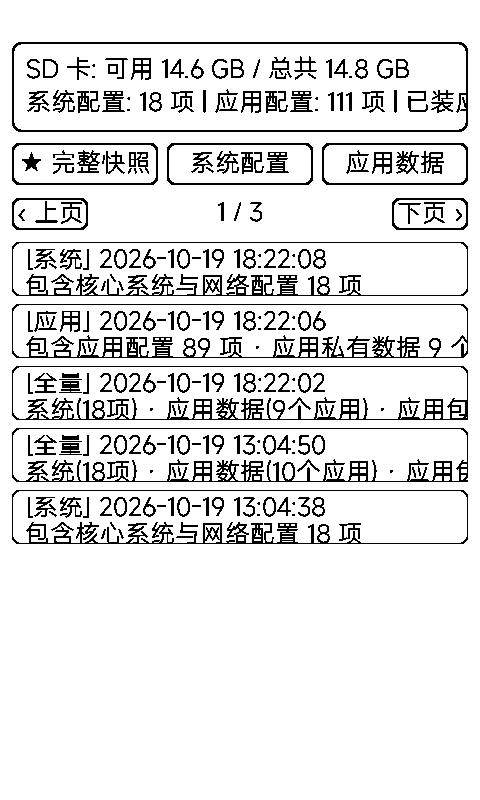

# 备份恢复（backup）

整机快照工具：**系统配置 / 应用数据 / 应用包**三层备份到 SD 卡，换机、刷机、大胆折腾的后悔药。

## 三层备份模型

| 层 | 内容 |
|:---|:---|
| **系统配置** | 系统 NVS 命名空间（wifi / settings / power / mcp / board 等）——网络、功耗、配对信息 |
| **应用数据** | 各应用自己的 NVS + 沙箱 `data/` 文件（存档、配置、收藏） |
| **应用包** | `apps/<name>.app` 整目录（代码 + 图标 + 资源） |

自动排除射频校准（phy）与驱动状态（nvs.net80211）——这两样恢复反而有害。

## 界面与操作

- 状态卡：SD 可用 / 总量 + 「系统配置 N 项 | 应用配置 N 项 | 已装应用 N 个」
- 三个备份按钮：**★ 完整快照 / 系统配置 / 应用数据**
- 快照列表翻页浏览（每页 5 条，带 [全量] / [系统] / [应用] 标签、时间与内容摘要）
- 点快照弹管理窗：**恢复全部（重启生效）/ 仅应用数据（即时重载）/ 仅系统配置（自动重启）/ 删除**

## 存储位置

`/sdcard/metalio/e-ink/backup/<时间戳_类型>/`，内含 `backup_meta.json`、`system_config.json`、`app_config.json`、`app_data/`、`app_bundles/`——拔卡就能拷走整套备份。

> 恢复系统配置后建议重启；快照损坏会明确报失败，不会半途写坏现机配置。
