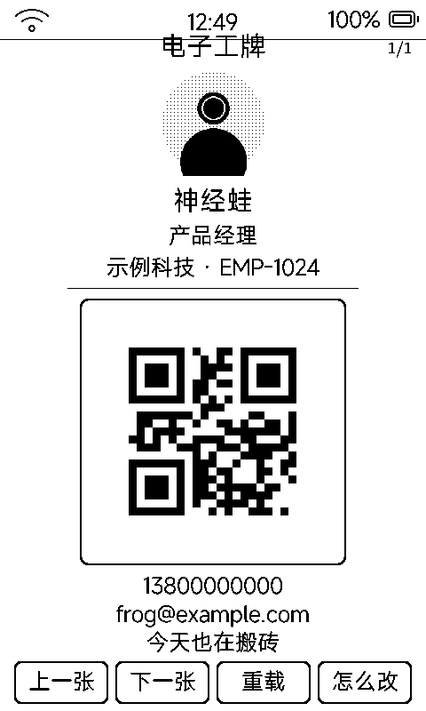

# 电子工牌（badge）

挂在胸前 / 摆在桌上的身份卡：**大头像 + 大字**，隔着半米也能看清你是谁。支持多张身份页轮播。

## 和「电子名片」的分工

| | 电子工牌 | 电子名片 |
|:---|:---|:---|
| 场景 | 挂着看 | 递出去交换 |
| 重点 | 头像大、名字大、一眼看清 | 身份 + 多个码入口 |
| 码 | 一张（够扫就行） | 多张，标签切换 |

## 界面

- 全部居中排版 + 大量留白：工牌是「看」的，不是「读」的
- 层级：姓名（30 号粗）> 职位 > 公司 / 联系方式（灰），一条细线分段
- 中央大头像 + 下方一张码
- 右上「1/2」页指示；底部**上一张 / 下一张 / 重载 / 怎么改**——可配多套身份（如公司 / 社团）轮播

## 配置

`data/profile.txt` 放应用沙箱（姓名 / 职位 / 公司 / 联系方式 / 码内容 / 头像图片），格式见 [`tools/badge_app/README.md`](../tools/badge_app/README.md)。

## 墨水屏上的讲究

工牌是常显场景：静态排版、一次刷新长期挂机；息屏待机也能配合同类壁纸常显身份（墨水屏断电不丢画面）。
