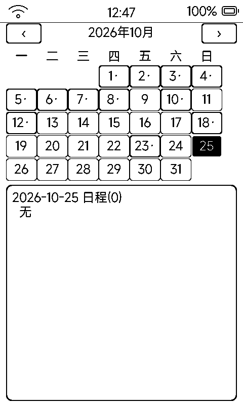

# 日历（cal）

月历 + 日程查看：与固件日历服务打通，AI 语音建的待办、ICS 订阅的日程都在这里看到。

## 界面

- 顶部月份栏：‹ + 「YYYY 年 MM 月」 + ›（跨年自动进位）
- 月历网格：**周一开始**，今日黑底反白、选中日 3px 粗边框、有日程的日期数字后带「·」
- 底部日程面板：「日期 · 日程 (N)」+ 每条「时间 标题」，无日程显示「无」

## 操作

- 点日期选中并刷新下方日程面板
- ‹ › 翻月；盖板 `vk_prev` / `vk_next` 直接上 / 下个月

## 日程从哪来

应用自身无持久化，全部走**固件日历服务**：

- **AI 语音创建**：AI 对话里说「明天下午三点提醒我开会」，日程由云端写入
- **MCP 工具**：`self.calendar.*` 系列增删查
- **ICS 订阅**：订阅日历自动刷新（数据独立存 SD 的 `ics_events.json`）
- 未对时时显示「未对时，无法确定当前日期」——先到「时间校准」对时
