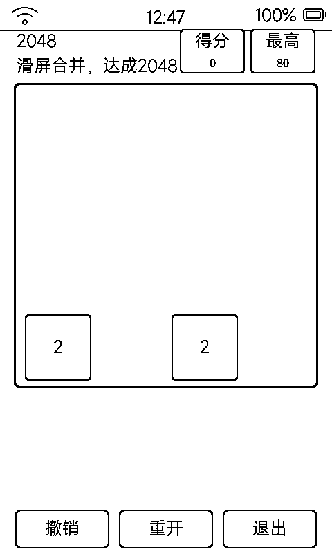

# 2048（game2048）

经典 2048 合并数字：滑动换向、同数合并，达成 2048。

## 界面与操作

- 4×4 棋盘 440px（格 96px）；右上「得分 / 最高」两个分数盒
- **棋盘上滑动**换向（也响应手势）；盖板 `vk_prev` / `vk_next` = 左移 / 右移
- 底部三键：**撤销（单步） / 重开 / 退出**
- 合成 2048 弹胜利框可继续；无路可走弹结束框
- 最高分存 `data/hiscore.txt`

## 1bpp 的灰阶编码

墨水屏没有灰度，数字块用**填充明暗 + 字号递减**分层：

| 数值 | 画法 |
|:---|:---|
| 2 / 4 | 白底黑字 |
| 8 ~ 64 | 灰色系五级浓淡（LVGL palette 灰阶在 1bpp 上按明暗映射） |
| ≥128 | 黑底白字 |

字号随数值位数 34 → 24 递减；中文标签 25 号、纯数字 18 号拉丁字，避免大字顶掉中文。

## 墨水屏上的讲究

- 每格状态指纹缓存，值没变不动 LVGL；每 15 步手动全刷去残影
- 新块 2（90%）/ 4（10%）随机出现，与原版一致
