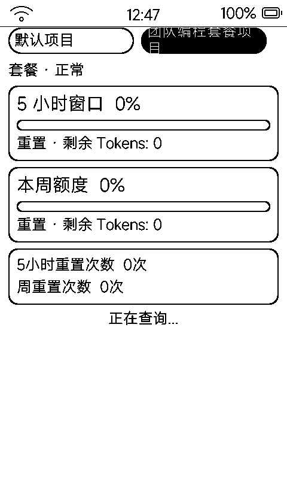

# GLM 用量（glm）

智谱 BigModel API 套餐额度监控：5 小时窗口、本周额度、重置次数，多机构 / 项目一键切换。

## 界面

- 顶部多上下文胶囊行（选中的黑底白字）+ 套餐等级标签
- 三张卡片：
  - **5 小时窗口**：百分比 + 进度条 + 重置剩余 Tokens
  - **本周额度**：同构
  - **5 小时 / 周重置次数**
- 底部状态行：未配 Key 提示 / 正在查询 / 失败原因 / 已就绪

## 操作

- 点胶囊或 `vk_prev` / `vk_next` 在多机构 / 项目间循环切换
- 1 秒定时器轮询刷新；`vk_home` 返回

## 配置

- API Key 经设备 MCP 工具 `self.glm_usage.configure` 下发（界面页脚同样提示）——Key 不落屏幕、不明文进应用包
- 设备端用 `id.secret` 现算 HS256 JWT 调 BigModel 接口（`getCustomerInfo` 发现机构 / 项目，`quota/limit` 查额度，`customer-package-reset/list` 查重置次数），JWT 不落盘
- 多机构 / 项目上下文与激活项存 NVS `glm` 命名空间
