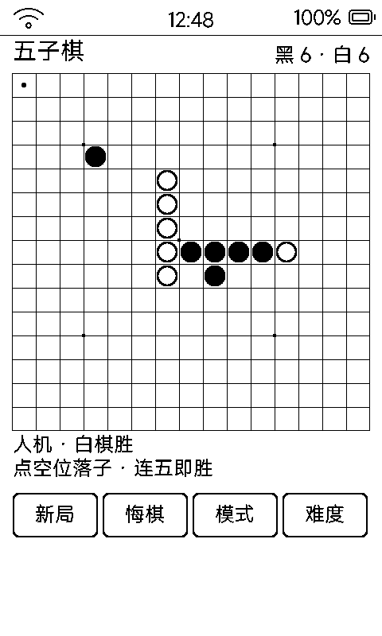

# 五子棋（gomoku）

回合制五子棋，**人机对战或双人同机**，一步一刷适配墨水屏。

## 界面与操作

- 15×15 棋盘（450px，天元 + 四星位），右上计子「黑 X · 白 Y」
- 点空位落子；最后一手用反色小圆点标记
- 底部四键：**新局 / 悔棋 / 模式 / 难度**
- 模式在人机 / 双人同机间循环；人机固定你执黑先行；难度简单 / 普通 / 困难三档
- 悔棋：人机模式连退两手（电脑 + 自己），双人退一手
- 存档自动落 `data/gomoku.txt`，重进续盘

## 电脑 AI

形状打分启发式：连五 1000000 分 > 活四 > 冲四 > 活三 > 眠三 > 活二……攻防加权：

- **简单**：只搜已有棋子邻位，防守权重低（适合陪小孩）
- **普通**：全盘扫描，攻 80 / 防 100
- **困难**：全盘扫描，攻 100 / 防 120

电脑落子延迟 600ms——先让你看清自己那手上了屏（墨水屏刷一帧 0.3~1 秒），再下给出反应时间。

## 墨水屏上的讲究

- 落一子只改一个 26px 棋子对象，脏区极小局刷快
- 黑子实心、白子黑描边（白底上纯白子不可见）
- 空位热区不用隐藏属性——LVGL 命中测试会跳过隐藏对象，就点不到了
- 空闲 3.5 秒落盘、6 秒全刷去残影，每 12 步强制全刷
