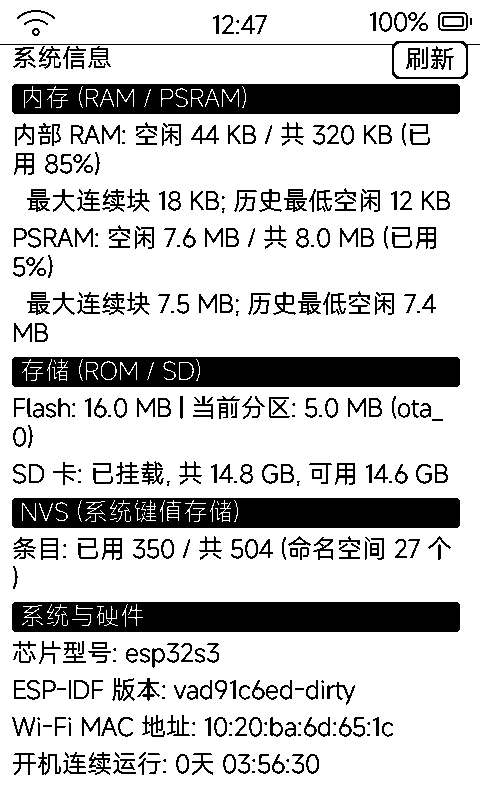

# 系统信息（info）

只读的系统仪表页：内存、存储、NVS、硬件信息一屏看全，排查问题第一步来这里。

## 四段信息

| 分区 | 内容 |
|:---|:---|
| **内存** | 内部 RAM：空闲 / 总量 / 已用百分比 / 最大连续块 / 历史最低空闲；PSRAM 同五项 |
| **存储** | Flash 容量、当前 app 分区大小与标签、SD 卡挂载状态与总量 / 可用 |
| **NVS** | 已用 / 总条目、命名空间个数 |
| **系统与硬件** | 芯片型号、ESP-IDF 版本、Wi-Fi MAC、开机连续运行时长 |

- 右上「刷新」按钮重新采样并提示
- 数据全部来自固件 `dynapp_sysinfo_get` 快照，应用自身不落盘

## 什么时候用得上

- **发 HTTPS 前看内存**：内部 RAM 最大连续块 < 14KB 时硬发 HTTPS 可能把网络栈挤崩——天气 / GLM 用量类应用联网前都会预检这个值
- **看 SD 挂载**：应用商店 / 传书不工作时先确认 SD 是否挂载、还剩多少空间
- **反馈问题**：截图这页附上，定位快得多
