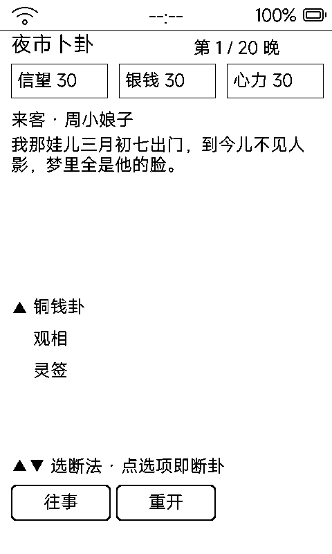

# 六爻占卜（liuyao）

摇六爻成卦、看本卦变卦、断所问之事——**65 卦内置**，逐爻摇、逐爻刷，仪式感拉满。

## 流程

1. **选所问之事**：8 类——事业 / 财运 / 姻缘 / 健康 / 出行 / 寻物 / 考试 / 官非
2. **起卦**：每 1.1 秒摇一爻（esp_random 模拟三枚铜钱：三背老阳动 / 两背少阳 / 一背两字少阴 / 三字老阴动）
3. **看卦**：双列几何卦图——本卦 + 变卦，阳爻整段、阴爻两段、动爻标「动」，中缝「之」字相连
4. **断语**：卦辞断语 + 按所问类别的吉 / 平 / 凶断语，最后「再问一卦」

## 数据

- 65 卦（通行本 64 卦 + 补「坎上乾下」变卦用）全部编译进代码：卦名 / 象意 / 断语 / 吉凶
- 每类 3 条吉 / 平 / 凶断语模板
- 存档 `data/liuyao.txt`（LYAO1）：类别 / 六爻值 / 阶段——**重进可恢复半摇状态接着摇**

## 墨水屏上的讲究

- 卦象纯几何黑条呈现 1bpp；摇卦**逐爻局刷**（每爻只刷一小块），仅成卦 / 进断语时全刷
- 起卦页 `vk_prev` / `vk_next` 循环选类别；卦象页与断语页分离，一屏一段无滚动
