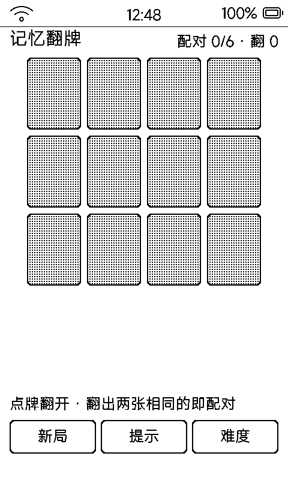

# 记忆翻牌（mem）

回合制翻牌配对：翻两张、对上消掉，6 对 / 8 对两种规模，一步一刷。

## 界面与玩法

- 一屏 4×4（6 对局 3×4）暗牌，翻开的牌白底黑字 + 黑框，配对成功的牌框加粗
- 牌面符号用字体包现成字形：♠ ♥ ♦ ♣ A J Q K——不自画几何图形，字体边缘更干净
- 牌背为 **25% 网点浅灰**：原来 16 张实心黑牌让整屏 43% 是死黑（局刷留灰影、刷新慢），换网点后黑色占比降到 15%

## 操作

- 点牌翻开，两张相同即配对；不同则翻回
- 支持双人轮流比记忆（回合制）
- 盖板虚拟键返回 / 重开

## 墨水屏上的讲究

- 网点相位以每张牌自己的左上角为原点，逐张不同——正常现象不是 bug
- 细线上的网点会被抖没：网点底上要画线得用**白**色才看得见
- 一步一刷，配对/翻回只刷动的两张牌
