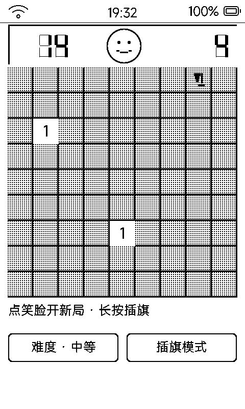

# 扫雷（minesweeper）

经典扫雷的 **1bpp 墨水屏复刻**:把 Windows 扫雷的三个招牌元素——立体砖块、LED 计数器、笑脸按钮——全部翻译到黑白硬阈值屏上。回合制、一步一刷。




## 界面(照经典 Win95 扫雷设计)

| 区域 | 画法 | 为什么 |
|:---|:---|:---|
| **立体砖块** | 未翻开 = 25% 网点灰面 + 右下 3px 黑边(凸起);翻开 = 纯白无边(凹陷) | 经典扫雷的"凸起砖/凹陷坑"在 1bpp 上的直译——灰面用 Bayer 网点,黑边自带格线,一屏立刻有"挖开"的层次(v1 的白底黑框完全没层次) |
| **LED 计数器 ×2** | 七段数码管(与番茄钟同源):左边剩雷数(雷−旗,可为负),右边计时(秒) | 经典排头;计时**只在操作时刷新**——墨水屏不能每秒刷屏,玩的时候时间照走,显示跟着操作走 |
| **笑脸按钮** | 玩 = 圆点眼微笑;输 = 闭眼皱眉;赢 = 墨镜。点它开新局 | 经典招牌;几何拼的,不依赖字体 |
| **数字** | 大号粗体居中(30@2) | 1bpp 没有红蓝绿;v1 的"数字+下方点阵"双编码在 50px 格子里糊成省略号,删掉 |
| **旗子** | 旗杆 + 三级阶梯三角旗 + 底座,占格 60% | v1 的旗小得像脏点 |
| **雷** | 圆核 + 十字臂 + 四角点 + 白色高光粒 | 高光让雷"立起来";踩中的那格**整格反色**(黑底白雷 = 经典红底炸弹) |

## 界面与操作

- 9×9 盘 450px;三档难度 = 10 / 15 / 20 雷(「难度」按钮循环,首点保证不踩雷)
- 点格子翻开;**长按插旗**;「插旗模式」切换后点格 = 插旗
- 点已翻开的数字格:周围旗数匹配时把其余空格一次翻开(chord)
- 翻开一片空白区只做一次局刷,不逐格刷;空闲 3.5 秒落盘、6 秒(真空闲)全刷去残影
- 踩雷:翻开全部雷、踩中格反色、笑脸变脸;扫清:全部找出、笑脸戴墨镜

## 存档

`data/minesweeper.txt`(MINE1):难度 / 旗数 / 翻开数 / 死活 + 81 格状态,重进续局。恢复的旧局没有"首点"时刻,第一次任何操作补开计时表。

## 构建 / 部署

```bash
./tools/package_app.sh tools/minesweeper_app
./tools/package_app.sh tools/minesweeper_app --upload <IP> --pin <PIN>
```
