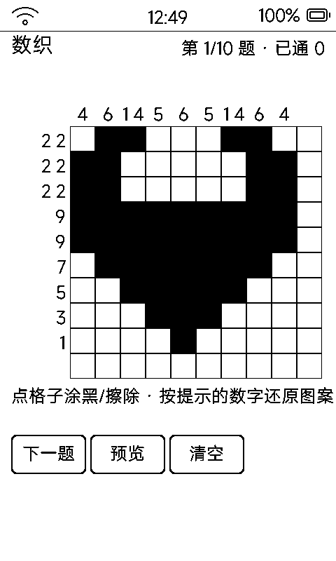

# 数织（non / Nonogram）

按行列数字提示还原图案的逻辑解谜，**10 幅内置图案**，一步一刷。

## 界面与玩法

- 左侧行提示 + 顶位列提示 + 10×10 盘 360px；左上角有 44px 缩略图（按「预览」显隐，卡住时对答案）
- 点格子涂黑、再点擦除（没有叉号标记——1bpp 上叉号与实心块容易混淆）
- 全对（涂黑与目标一致）判通关并记录；底部三键：**下一题 / 预览 / 清空**
- 内置 10 幅 10×10 图案：心、星、鱼、房子、树、猫脸、伞、笑脸、花、帆船；行列提示数字由图案自动算出游程

## 存档

`data/non.txt`（NON1）：题号 / 步数 + 涂色 + 通关表，每次点击即落盘。

## 墨水屏上的讲究

- 填一格只改一个对象；每 12 步全刷
- 图案库用纯字符数组而非指针表——Xtensa 位置无关代码下全局指针表每项要重定位，动态应用读会触发 LoadProhibited 崩溃（动态应用 C 开发的隐蔽坑）
- `vk_next` 直接跳下一题
