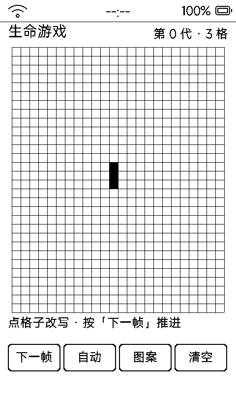

# 夜市卜卦（ntbk）

抉择式文字冒险：你是夜市卦摊先生，**20 晚 20 位来客**，断对断错全在一念——纯文字一步一刷，最省墨水屏的玩法。

## 玩法

- 每晚来一位客人（20 位内置，随机洗牌出场），讲述来意
- **三种断法**，各有所长：
  - **铜钱卦**：必准，但耗心力 2 点
  - **观相**：免费，只对「身体事」准
  - **灵签**：花银钱 2，只对「心结」准
- 断对：信望 +1、银钱 +1；断错：信望 −1
- 三项数值（信望 / 银钱 / 心力，初始各 30）**任一归零即散场结局**；撑过第 20 晚出师（按数值分三档结局文案）
- 「往事」可回看每晚选择与结局

## 界面与操作

- 一屏一段故事：标题 + 第 N/20 晚 + 三数值框 + 来客叙述（≤7 行不滚动）+ ▲光标三断法 + 结果文本
- 点按选项即断卦；点「下一晚」推进
- `vk_prev` / `vk_next` 上下选断法、往事里翻页
- 存档 `data/ntbk.txt`（NTBK1），操作后 3.5 秒空闲落盘

## 墨水屏上的讲究

一屏只刷一次（叙事 + 选项 + 数值全静态）；自实现 UTF-8 边界截断，存档里绝不出现半个汉字；每 8 次交互空闲 6 秒全刷去残影。
