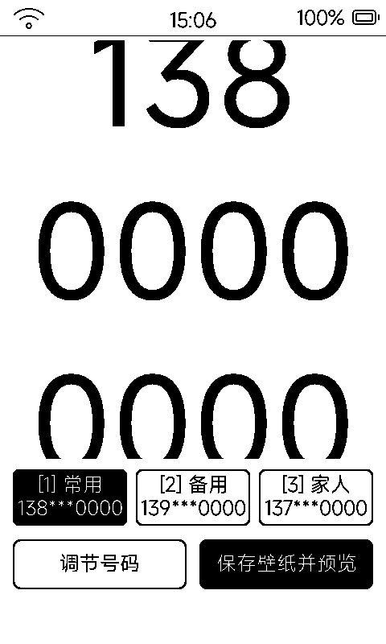

# 挪车电话（parking）

超大号挪车电话牌：**160px 高的 MiSans 大数字**按 3+4+4 分段，远距离一眼可读；一键生成成待机壁纸，息屏状态就是挪车牌。

## 界面与操作

| 区域 | 内容 |
|:---|:---|
| 主屏 | 中央三行超大数字（如 138 / 0000 / 0000）+ 三个槽位按钮（常用 / 备用 / 家人，激活槽黑底反白，非当前号码打码显示） |
| 底部 | 「调节号码」+「保存壁纸并预览」 |

- **调节号码弹窗**：11 列数字滚轮格，每列 ▲ / 数字 / ▼ 步进（▲ 减 1、▼ 加 1）；顶部槽位胶囊切换，实时预览
- **保存壁纸并预览**：把当前号码栅格化成 A2I1 位图写入 `/sdcard/metalio/e-ink/wallpaper/parking_board.a2i1` 并设为待机常显——**息屏 / 关机画面都显示号码**，全屏预览点任意处返回

## 数据

`data/config.json`：激活槽位 + 3 组号码（名称 + 号码），应用沙箱存储，重装不丢。

## 墨水屏上的讲究

- 应用内嵌专用 **160@2 数字字库**，号码展示「无任何废话」，专为远距离可读设计
- 手写 A2I1 生成器直接把字模栅格化进位图（仅 48KB 缓冲），不走 LVGL 截屏
- PC 端等价渲染脚本 `tools/parking_app/render_wp.py` 可预览壁纸效果
