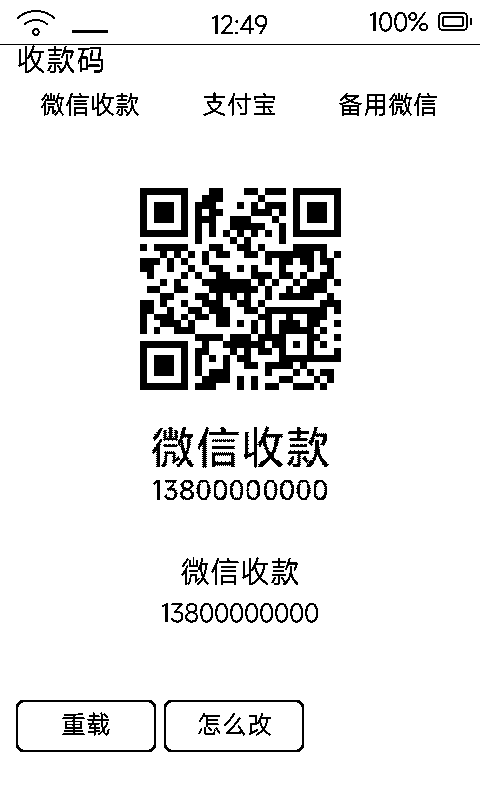

# 收款码（paycode）

把微信 / 支付宝收款码摆在墨水屏上，客人扫码付款——摊主把设备立在台面就行。

## 为什么单独做一个

名片是「我是谁」，收款码是「收钱」，场景完全不同：屏幕要**大、清楚、只有一个码**。塞进名片里跟身份信息挤在一起，两边都看不清。

## 界面

- 顶部标签行：**微信收款 / 支付宝 / 备用微信**……点标签换码
- 中央大码卡 + 码类型名 + 账号尾号
- **点一下码 → 全屏展示**：整屏只剩一个 440px 的大码，递给客人最稳（再点退回）
- 底部「重载 / 怎么改」

## 设计取舍

- **不做聚合码**：微信 + 支付宝二合一的「一个 URL 码」需要公网服务器按 User-Agent 跳转——墨水屏是纯离线设备做不了。诚实的做法是**多张码摆出来，点标签切换**
- 彩色收款码自动灰度 + Bayer 抖动适配 1bpp；微信 / 支付宝的码本来就是黑白高对比，扫得动
- 支持配多张备用码（换号不影响收款）

## 配置

码图片与账号信息放应用沙箱 `data/`（图片直接拷入，清单文本配置），格式见 [`tools/paycode_app/README.md`](../tools/paycode_app/README.md)。
