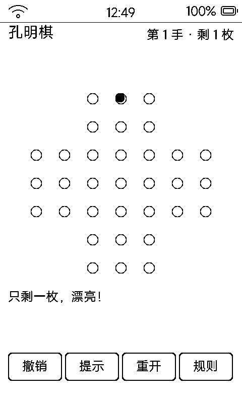

# 孔明棋（peg）

Peg Solitaire 经典独粒钻石棋，**英文十字盘 33 洞**，纯几何棋面零字体依赖，一步一刷。

## 界面与玩法

- 7×7 盘面中的英文十字形 33 洞：开局 32 子、中心空
- 规则：像跳棋一样横竖隔一子跳、吃掉被跳过的子；**剩 1 子**判通关
- 点棋子选中（描边）→ 点两格外空洞跳入
- 右上「第 X 手 · 剩 Y 枚」；有一步可走时会自动圈出提示
- 底部四键：**撤销 / 提示 / 重开 / 规则**（规则浮层一整页文字卡，可开关）
- `vk_prev` 悔棋、`vk_next` 提示（提示圈出落点后，点被圈的空洞直接执行）

## 存档

`data/peg.txt`（PEG1）：手数 + 33 格状态 + 完整跳子历史（支持一路悔到开局），每跳即存。

## 墨水屏上的讲究

- 洞 = 空心圆、棋子 = 实心圆，全盘零字体、零位图——最不容易糊的画法
- 一次跳子只改起点 / 被吃 / 落点三个对象，脏区极小，一次只刷一小片
