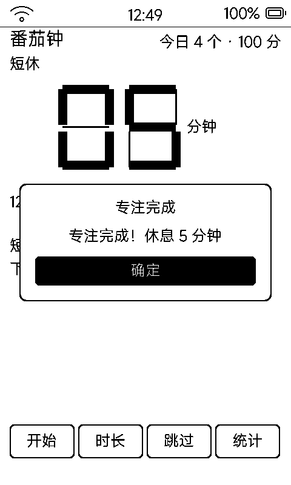

# 番茄钟（pomo）

专注 / 休息循环计时器：**七段数码管 + 每分钟排水条**，不跳秒、不烧屏，断电重启计时照走。

## 界面

| 区域 | 内容 |
|:---|:---|
| 阶段标签 | 专注 / 短休 / 长休 |
| 主显示 | 两位七段数码管剩余分钟（灭段只画 3px 细线 ghost） |
| 起止行 | 如「14:30 → 15:00 结束」 |
| 排水条 | 每过一分钟长一格，进度一眼可见 |
| 底部 | 开始（暂停/继续）/ 时长 / 跳过 / 统计 |

## 规则

- 专注档 **15 / 25 / 45 / 60 分钟**（默认 25），短休 5 分钟、长休 15 分钟，每 4 个番茄进长休
- 阶段完成弹窗提醒
- **基于墙钟结束时刻**：断电 / 重启 / 退出后计时照走，重进自动恢复——不是靠 MCU 数秒
- `vk_home` 退出应用但后台继续计时

## 统计页

今日 / 累计番茄数 + **近 7 天柱状图**（带数字与日期），一次画完一天不重刷。

## 存档

`data/pomo.txt`（POMO1）：阶段 / 状态 / 档位 / 结束时刻 / 今日与 7 天统计，状态一变立即落盘。

## 墨水屏上的讲究

主显示只给向上取整的剩余分钟，秒级 tick 只在分钟变化时才重绘——**不跳秒的代价是几乎不刷屏**。
