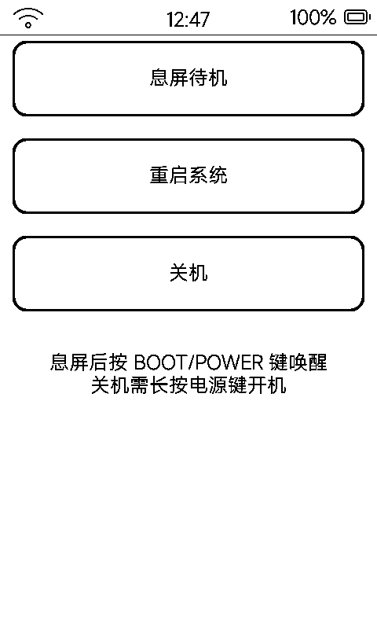

# 电源管理（power）

内置电源操作页：**息屏待机 / 重启系统 / 关机**三个大按钮，一眼找到。

## 三个动作

| 按钮 | 行为 |
|:---|:---|
| **息屏待机** | 立即进入待机 Overlay，墨水屏保留待机画面（经典时钟 / 壁纸）；POWER 短按唤醒 |
| **重启系统** | 弹确认框（「未保存的数据可能会丢失」），确认后重启 |
| **关机** | 弹确认框（「关机后需长按电源键开机」），确认后经 `PWR_KEY_PULSE` 软关机 |

## 相关功耗策略

空闲进待机、浅睡累计关机、CPU 降频、断网暂留等自动策略在「设置 → 功耗」配置（默认 3 分钟进待机、再 3 分钟累计关机）；电量与充电的硬件细节见 [`docs/battery-soc-and-charge.md`](battery-soc-and-charge.md)。

> 提示：待机状态下设备网络会断开，远程接口（8080）不可达——**不是死机**，按物理电源键唤醒即可。
