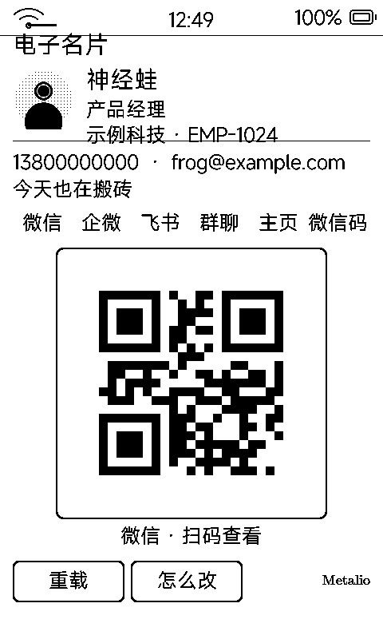

# 电子名片（qrcard）

一张能递出去的名片：**身份区 + 多个码入口**，点标签换码，扫码加微信 / 打开链接。

## 界面

| 区域 | 内容 |
|:---|:---|
| 身份区 | 头像 + 姓名 / 职位 / 公司·工号 + 联系方式 + 一句话签名 |
| 标签行 | 微信 / 企微 / 飞书 / 群聊 / 主页 / 微信码……**点标签换码** |
| 码区 | 一屏只放一个大码（240px，图片型码用满 340px 码卡） |
| 底部 | 「重载 / 怎么改」按钮 |

## 两种码

| 类型 | 配置写法 | 渲染方式 |
|:---|:---|:---|
| 文本码 | `微信\|mywechatid` | LVGL 自带 `lv_qrcode` 现场生成 |
| 图片码 | `公众号\|qrcode.png` | 直接显示你提供的图片（如微信带 logo 的码） |

## 二维码扫出来的两个铁律

- **静区**：码四周必须留足白边（标准要求 ≥4 模块），细边框画在白边之外——紧贴码的黑框会让微信 / 支付宝扫不出来
- **载荷要短**：码 240px 起，载荷越长模块越密就越扫不动

## 配置

`data/profile.txt` 放应用沙箱，格式与完整示例见 [`tools/qrcard_app/README.md`](../tools/qrcard_app/README.md)；头像与图片码直接传进 `data/`。改完点「重载」即时生效。
