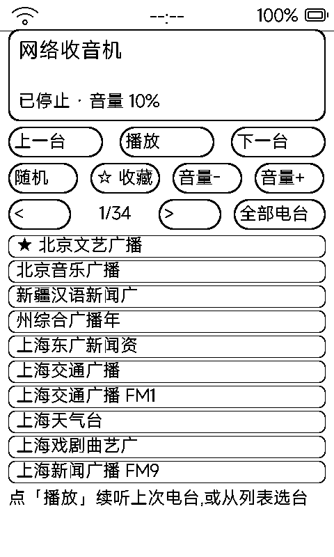

# 收音机（radio）

网络流媒体收音机：把电台直播流地址写进清单文件，墨水屏选台、外放喇叭出声。

## 它能做什么

- 播放任意 HTTP / HTTPS 网络电台直播流（MP3 / AAC 等）
- 电台清单完全自定义，支持三种格式（任选其一）：
  - **`stations.json`**（推荐）：`[{"name": "中国之声", "url": "https://...mp3"}, …]`
  - **`stations.m3u`**：标准 M3U 播放列表
  - **`stations.txt`**：一行一个 `名称|地址`
- 清单检索路径（按优先级）：
  1. `/sdcard/metalio/e-ink/radio/stations.*`（公共推荐，电脑/手机文件管理直接放）
  2. `apps/radio.app/data/stations.*`（应用沙箱）
- 首次运行若无清单，自动在 `data/stations.json` 生成示范文件，照着改就行

## 操作

- 触屏选台 / 暂停；盖板虚拟键翻台；底部按钮行退出
- 声音经 I2S + 外置蓝牙音频芯片外放（或蓝牙模式 2/3 走耳机 / 音箱）

## 墨水屏上的讲究

- 选台 / 状态变化才局部刷新，播放中屏幕保持安静
- 音频缓冲与网络重连由固件音频服务托管，断流自动恢复
