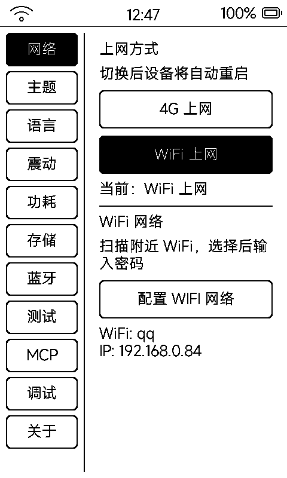

# 设置（set）

内置系统设置：左侧 Tab 列表 + 右侧内容页，进 Tab 才构建、离 Tab 即销毁，省内存。

## Tab 一览

| Tab | 内容 |
|:---|:---|
| **网络** | WiFi / 网络源选择、实时 SSID 与 IP、WiFi 扫描配网（AP 名形如 `MetalioEInk4-xxxx`） |
| **主题** | 桌面卡片样式：白底 / 网点灰 / 黑描边 |
| **语言** | 界面语言切换 |
| **触感** | 按键震动反馈开关 |
| **功耗** | 进待机时长（3/10/30 分）、浅睡累计关机、AppIdle CPU 频率（80/160/240 MHz）、断网暂留（30/60/120 秒） |
| **存储** | SD 容量信息；**启用 / 停用虚拟 U 盘**（USB MSC，与烧录口互斥） |
| **蓝牙** | 外置蓝牙音频芯片三种模式切换、扫描配对 |
| **测试** | 厂测入口（自动测试 / 触摸 / 电池 / 老化），日常可忽略 |
| **MCP** | 局域网 MCP 开关、**6 位 PIN 码大字显示与重新生成**——`http://<设备IP>:8080/mcp` 靠它鉴权 |
| **调试** | 调试开关 |
| **关于** | 型号、芯片、固件版本、MAC、Flash、PSRAM |

## 两个高频用法

- **查 IP 和 PIN**：网络 Tab 看 IP，MCP Tab 看 PIN——远程截图 / 推应用 / MCP 工具全靠这对组合
- **虚拟 U 盘**：存储 Tab 启用后设备变 U 盘，直接往 SD 拷书、拷应用包；用完先安全弹出再停用（与 USB 烧录共用端口，互斥）
