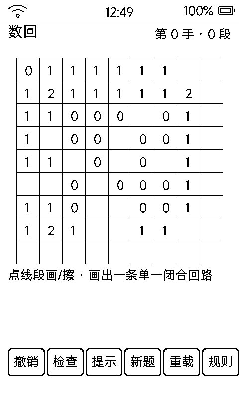

# 数回（slink / Slitherlink）

纸上逻辑谜题：按格点数字提示**画出一条单一闭合回路**，关卡程序生成、无限供应。

## 界面与玩法

- 8×8 格点阵（9×9 顶点，格 46px），画上的边是 6px 黑粗条，与 1px 淡网格一眼可分
- 数字 = 该格四周被画上的边数；目标：所有数字满足，且线连成**一个**闭合圈
- 点按「离手指最近的线段」画 / 擦；不用逐格找热区
- 底部六键：**撤销 / 检查 / 提示 / 新题 / 重载 / 规则**
  - **检查**：校验数字满足 + 单一闭环，结果常驻状态行（墨水屏 toast 一闪看不清）
  - **提示**：圈出标准解里还没画的一段
- `vk_prev` 悔棋、`vk_next` 检查

## 关卡生成

- 顶点图随机自避游走闭合成简单回路（校验每顶点度数 0 或 2），失败退回随机矩形兜底
- 按回路反算提示数字，再随机挖掉约 25%
- 可复现 xorshift 种子存进存档——读档按种子重算标准解供「提示」用

## 存档

`data/slink.txt`（SLK1）：种子 / 手数 / 胜态 + 144 条边 + 完整悔棋历史，每次落边即存。

## 墨水屏上的讲究

- 改一条边只改 2 个对象，脏区极小
- 刻意**不**建 144 个点击热区——会把固件触觉区表（96 项）撑爆报 `zone table full`，且顶点处四热区重叠点不准；整面单对象 + 最近边判定才是正解
