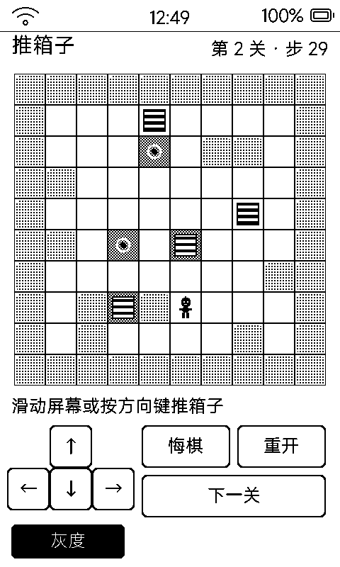

# 推箱子（sok）

经典 Sokoban，**关卡逆向生成保证有解**，一步一刷，玩家是一个可爱小人。

## 界面与玩法

- 每格是独立 tile：白底格线地板、圆角黑砖墙（留 2px 白缝）、**横纹木箱**、靶心目标点
- 箱子推到靶心**整格反色**，一眼看出归位
- 玩家 = 大头小人（白方眼 + 笑嘴 + 呆毛 + 圆胖身子）——最初画「实心黑点」，用户反馈「哪个是用户根本看不懂」
- 点屏幕相对方向推动，或用盖板虚拟键；支持悔棋
- 关卡程序生成并**逆向校验有解**，不会出现死局

## 灰度模式（Bayer 网点）

左下角「灰度」开关，一键在黑白 / 网点灰之间切换：

| 元素 | 黑白模式 | 灰度模式 |
|:---|:---|:---|
| 墙 | 实心黑砖 | 25% 网点浅灰砖（箱子立刻跳出来） |
| 目标格 | 白底黑靶心 | 50% 网点中灰地砖 + 白环靶心 |
| 箱子 / 人 | 黑底白带 / 实心 | 不变（保持最深） |

## 存档

`data/` 沙箱存当前关卡与步数；重装应用不丢进度。

## 墨水屏上的讲究

- 箱子用对象池（最多 6 箱 × 3 条带 = 24 个对象），比「每格一个箱子」省一半 LVGL 堆
- 斜纹在 1bpp 上要么糊、要么缺 API 画不了，横带用纯矩形子对象最干净
- 设计细节详见 [`tools/sok_app/README.md`](../tools/sok_app/README.md)
