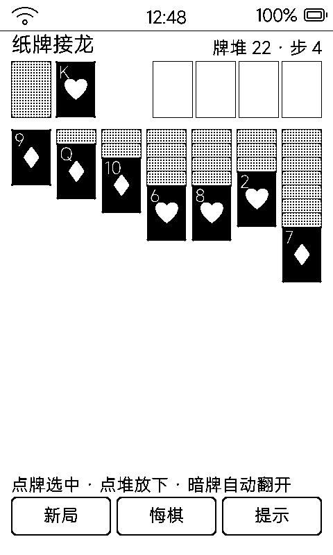

# 纸牌接龙（sol）

经典 Klondike 接龙，回合制一步一刷，52 张牌全用几何绘制。

## 界面与玩法

- 标准接龙布局：牌堆 + 4 个回收堆在上，7 列牌桌在下
- 1bpp 没有红黑花色之分，用**明暗分阵营**：
  - 红花色（♥♦）明牌 = **黑底白字**
  - 黑花色（♠♣）明牌 = 白底黑字
- 点选牌 / 点目标位移动，规则校验（点数递减交替色、回收堆同花色升序）
- 牌背是 **25% 网点浅灰** + 黑框——原来画实心黑牌，牌堆一压一大片死黑，又丑又费墨

## 操作

- 触屏点按为主；盖板虚拟键辅助
- 移动只重排受影响的 1~2 个堆，脏区小、局刷快

## 墨水屏上的讲究

- 52 张牌常驻 52 个对象 + 各自标签；有「样式没变就不重绘」的渲染缓存——翻牌回正面时要主动失效缓存，否则牌背的灰底撤不掉（开发时踩过的真坑，详见 [`tools/sol_app/README.md`](../tools/sol_app/README.md)）
- 大块网点灰由 `tools/_shared/gray_dither.h` 的 Bayer 抖动实现，与固件桌面卡片灰底同一套做法
