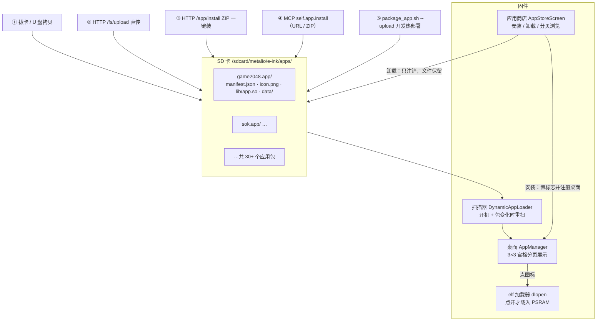

# 应用商店与动态应用机制

Metalio E-Ink 4 的应用生态建立在「**应用包（.app Bundle）+ 沙箱 + 热加载**」之上：应用独立打包放在 SD 卡上，免刷机分发、免重启安装，点开即运行、退出即释放。本文讲清楚这套机制的全貌；逐个应用的介绍见 [中文 README「应用全景」](../README_zn.md#2-应用全景)，开发规范细节见 [`docs/dynamic-apps.md`](dynamic-apps.md)。


---

## 1. 一图看懂



---

## 2. 应用包（.app Bundle）结构

借鉴 macOS Application Bundle，每个应用是 SD 卡上一个目录：

```text
/sdcard/metalio/e-ink/apps/<AppName>.app/
├── manifest.json   [必需|只读] 元数据：id / name / version / abi / executable
├── icon.png        [可选|只读] 70×70 黑白 PNG 桌面图标
├── lib/app.so      [必需|只读] ELF 动态库（dlopen 载入，路径强制唯一）
├── resources/      [可选|只读] 静态资源（关卡、词库、字模等，应用只可读）
└── data/           [自动创建|可写] 应用私有沙箱，重装/升级绝不覆盖
    ├── config.json 用户配置
    ├── state.json  进度 / 存档 / 最高分
    └── cache/      临时缓存
```

`manifest.json` 示例：

```json
{
  "id": "sok",
  "name": "推箱子",
  "icon": "icon.png",
  "executable": "lib/sok.so",
  "abi": 1,
  "version": "1.0.0",
  "author": "Metalio",
  "description": "经典推箱子，关卡逆向生成保证有解"
}
```

关键约束：

| 项 | 规则 |
|:---|:---|
| `abi` 闸门 | 必须等于固件 `METALIO_DYNAPP_ABI_VERSION`（当前 1）。固件大版本升级若改 ABI，不匹配的包在扫描阶段直接拦截并提示，**不会带病加载崩溃** |
| `data/` 防覆盖 | 更新 / 重装只替换 `manifest.json`、`icon.png`、`lib/app.so`，**`data/` 永不触碰**——用户配置、游戏存档无缝热升级 |
| 禁用 NVS | 动态应用禁止写 NVS（整机仅 16KB，要留给系统）；一切可变状态必须落 `data/`，JSON 文件化 |
| 路径沙箱 | 只允许写自己的 `data/`；拒绝 `..` 穿越、绝对路径、反斜杠；读可放宽到自身 bundle、系统字体 / 壁纸 |

---

## 3. 生命周期：平时零开销，点开才加载

1. **扫描登记**：开机及包变化时，扫描器解析每个 `manifest.json`，只向桌面登记「图标 + 名字 + 入口」——数十字节内存，不执行任何应用代码。
2. **点开运行**：`dlopen` 把 `lib/app.so` 载入 PSRAM，解析固件导出的符号表（LVGL、libc、沙箱 API、TTS、异步 HTTP……），执行入口 `metalio_app_entry()` 创建屏幕。
3. **退出释放**：返回桌面后屏幕销毁，固件 `dlclose`，PSRAM 代码段彻底释放；遗留定时器若不清理会被生命周期回调兜住（应用侧仍必须自觉清理）。
4. **安装态持久化**：NVS `dynapp/in_<id>`，**缺省 = 已安装**——往 `apps/` 推一个新包，桌面自动出现图标，无需任何注册动作。

---

## 4. 应用商店界面

桌面上的「应用商店」图标（内置应用，id `store`）进入：

- 自动扫描 SD 卡 `apps/` 下的有效包，顶部显示「已识别 N 个应用」
- 每页 5 个应用卡片：名称 + 版本号 + ID + 安装状态，右侧「类 App Store」胶囊按钮
- **安装**：置安装标志并注册进桌面（黑底高亮按钮）
- **卸载**：只注销桌面入口并清标志，**包文件保留在 SD 上**，随时可再装回（白底线框按钮）
- 翻页：底部「◀ 上一页 / 下一页 ▶」、左右滑动手势、盖板 `vk_prev` / `vk_next` 三种方式等价
- 空列表时给出引导文案：把含 `manifest.json` 的包推到 `apps/` 即可

> 想让某个包「在 SD 上但彻底消失」（比如内部测试 App），在固件 `dynamic_app_loader.cc` 的 `IsRetiredAppId()` 列表加上它的 id 即可——扫描阶段直接跳过，商店里也不出现。

---

## 5. 五条安装渠道

| # | 渠道 | 适用场景 | 做法 |
|:---:|:---|:---|:---|
| ① | **拔卡 / 虚拟 U 盘** | 无网络环境 | 把 `<name>.app/` 目录拷到 `metalio/e-ink/apps/`；或「设置 → 存储」开 U 盘模式拖拽 |
| ② | **HTTP 文件直传** | 脚本 / 单文件更新 | `POST /fs/upload?path=apps/<name>.app`（带 `X-Filename` 头），推完自动重扫注册 |
| ③ | **ZIP 一键安装** | 完整包分发 | `curl --data-binary @app.zip POST /app/install`——自动找 manifest（根目录或一层子目录均可）、校验 ABI、解压到 `apps/<id>.app/`，上限 64 MB |
| ④ | **MCP 工具** | AI 代理 / 远程编排 | `self.app.install`（传 URL 或 SD 上的 zip 路径）、`self.app.list / get_info / uninstall / enable / disable` |
| ⑤ | **开发热部署** | 应用开发迭代 | `./tools/package_app.sh tools/<app> --upload <IP> --pin <PIN>` 编译打包推送一条龙，桌面秒级热刷新 |

渠道 ②③ 的 curls：

```bash
# 直传单个文件到应用包（app.so 更新最常用）
curl -X POST "http://<设备IP>:8080/fs/upload?path=apps/sok.app" \
  -H "X-Filename: app.so" -H "Authorization: Bearer <PIN>" \
  --data-binary @sok.so

# ZIP 整包安装 / 更新
curl -X POST "http://<设备IP>:8080/app/install" \
  -H "Authorization: Bearer <PIN>" --data-binary @sok.app.zip
```

ZIP 包内布局两种都认：`manifest.json` 在压缩包根目录，或在唯一的 `<目录>/manifest.json` 下。

---

## 6. 卸载、禁用与数据保留

| 操作 | 入口 | 效果 |
|:---|:---|:---|
| **商店卸载** | 商店页「卸载」 | 注销桌面 + 清安装标志；**文件保留**，可随时装回 |
| **彻底卸载** | MCP `self.app.uninstall` | 删除整个包目录；`keep_data=true` 可保留沙箱 `data/` |
| **临时禁用** | MCP `self.app.disable` | 保留包与安装标志，桌面暂时隐藏；`self.app.enable` 恢复 |
| **重装 / 升级** | 任一安装渠道重复推 | 只覆盖代码与资源，`data/` 原样保留 |

删除端点 `POST /fs/delete?path=apps/<name>.app` 会删文件并自动注销桌面入口。

---

## 7. 应用能调用哪些系统能力

动态应用只能调用固件符号表 `g_metalio_dynapp_syms` 显式导出的 API（未导出的符号 `dlopen` 直接报错，天然是能力边界）：

| 能力面 | 代表 API |
|:---|:---|
| 图形 | LVGL 9 全套常用接口（对象 / 样式 / 标签 / 图片 / 画布 / 动画） |
| C 标准库 | malloc / string / printf / math 等（newlib NANO） |
| 沙箱文件 | `dynapp_fopen_data` / `dynapp_get_data_path` / `dynapp_is_path_allowed` |
| 系统桥 | `dynapp_screen_status_bar`（状态栏）/ `dynapp_vk_attach`（虚拟键）/ `dynapp_screen_go_home` / `dynapp_lv_async`（跨线程投递 UI） |
| 字体 | `fontpack_lv_font_get(size, weight)` 全字重矢量点阵字库 |
| 墨水屏 | `dynapp_epd_full_refresh`（手动全刷去残影）等局刷 / 全刷控制 |
| **云能力** | `dynapp_tts_speak[_ex]`（MiniMax TTS 朗读）/ `dynapp_http_get_async`（带证书链的 HTTPS GET）/ `dynapp_sysinfo_get`（内存水位预检） |
| 压缩 | `dynapp_zlib_inflate`（知识卡片 4.4 万卡数据库靠它按卡解压） |

想开放新能力：在 `dynamic_app_loader.cc` 符号表加一行函数指针，重编固件即可，应用无需重编。

---

## 8. 远程编排接口一览（配合商店使用）

设备常驻 `http://<IP>:8080`（鉴权 `Authorization: Bearer <6位PIN>`，设置 → MCP 可查看 / 重生成）：

| 端点 | 方法 | 用途 |
|:---|:---:|:---|
| `/fs/list?path=…` | GET | 浏览 SD 目录（看装了哪些包） |
| `/fs/upload` | POST | 直传文件（推包 / 推 app.so） |
| `/fs/delete` | POST | 删文件 / 目录（卸包） |
| `/app/install`、`/app/upload` | POST | ZIP 一键安装 / 更新 |
| `/app/launch?id=<id>` | POST | 远程启动应用（自动化测试友好） |
| `/screen/screenshot` | GET | 当前屏幕 BMP 截图（文档配图就这么截的） |
| `/screen/home` | POST | 回桌面 |
| `/input/key`、`/input/click` | POST | 注入虚拟键 / 触摸点击 |
| `/system/ota` | POST | 静默远程 OTA |

本仓库文档里的 38 张真机截图，就是「`/app/launch` 启动 → 等 3 秒 → `tools/screenshot.sh` 截屏」循环批量产出的。

---

## 9. 自己做一个应用

最小路径（10 分钟）：

1. 拷 [`tools/hello_app/`](../tools/hello_app/README.md) 作为模板，改 `manifest.json` 的 `id` / `name`；
2. 在 `metalio_app_entry()` 里填自己的 `create` 屏幕函数——挂状态栏 `dynapp_screen_status_bar`、挂虚拟键 `dynapp_vk_attach`、数据读写走 `dynapp_fopen_data`；
3. 一键编译打包推送：`./tools/package_app.sh tools/your_app --upload <IP> --pin <PIN>`；
4. 桌面立刻出现图标，点开即用。

完整规范（沙箱 API、云能力、避坑清单、崩溃案例）见 **[`docs/dynamic-apps.md`](dynamic-apps.md)**。
