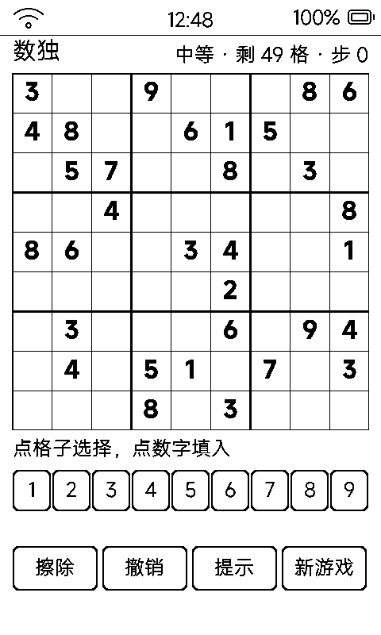

# 数独（sudoku）

回合制数独，**程序生成保证唯一解**，四档难度，一步一刷。

## 界面与操作

- 9×9 盘 450px 居中，宫格线每 3 格加粗；右上显示「难度 · 剩 X 格 · 步 Y」
- 点格子选中（反白）→ 点数字填入；再点同数字 = 擦除
- 数字键盘 1~9；底部四键：**擦除 / 撤销 / 提示 / 新游戏**
- 冲突格：3px 粗边 + 底部粗条双指示
- `vk_next` 直接换下一局（难度循环）

## 生成与难度

- 生成器：随机回溯填满整解 → 随机挖洞 → 位掩码求解器**校验唯一解**
- 四档难度 = 提示数 40 / 32 / 26 / 24（简单 → 中等 → 困难 → 专家）
- 悔棋栈 32 步；提示随机揭示一个正确格（细线标记）

## 存档

`data/sudoku.txt`（SUDOKU1）：连题目和答案一起存，重进接着玩。

## 墨水屏上的讲究

- 填一格只改一个 label；每格指纹缓存，81 格全重绘几百毫秒会吞掉 1/3 连点
- 双定时器：停手 3.5 秒落盘、**真空闲 6 秒才全刷**——全刷阻塞触摸 2~3 秒会丢一串点击，每 15 步触发一次
- 曾做同行/列/宫关联细框，实测 1bpp 上细框与宫格线难分且脏区翻倍，删了——**墨水屏 UI 做减法比加法难**
