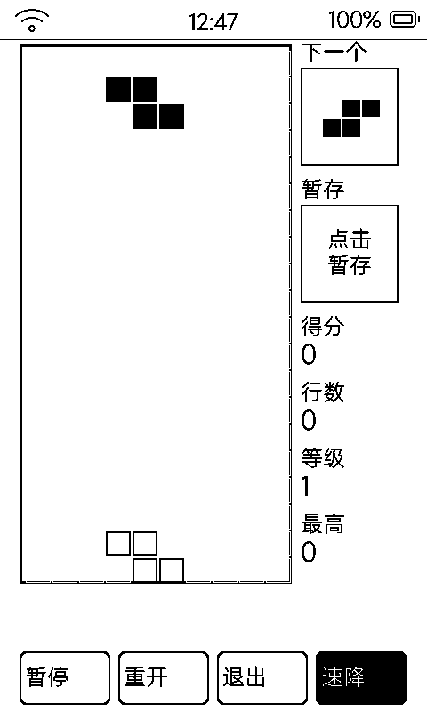

# 方块战争（tetris）

经典俄罗斯方块完整规则版：**hold 暂存、ghost 落点虚影、踢墙旋转、等级加速**。

## 界面与操作

- 左侧 10×20 棋盘（格 30px）；右栏「下一个」预览 + 「暂存」盒（点击换牌，一局一次）+ 得分 / 行数 / 等级 / 最高
- 盖板键：`vk_home` 旋转、`vk_prev` 左移、`vk_next` 右移
- 底部四键：**暂停 / 重开 / 退出 / 速降**（速降黑底反白）
- 计分：消 1~4 行 = 100 / 300 / 500 / 800 × 等级；每 10 行升一级，下落间隔 800ms 递减至 150ms
- 最高分存 `data/hiscore.txt`

## 完整规则

- 7 种方块 × 4 旋转态；旋转带 4 组**踢墙偏移**（贴墙也能转）
- **ghost 虚影**预告落点，直降不迷路
- 结束弹出白底卡片（得分 / 最高 / 点按重开）；暂停时计时器一并挂起

## 墨水屏上的讲究

- 200 个占格差量重绘（指纹缓存），预览区形状变了才摆
- 虚拟键回调在 esp_timer 线程，只投递状态、经 `dynapp_lv_async` 转 LVGL 线程动 UI（跨线程铁律）
- 每 10 块全刷一次去残影
