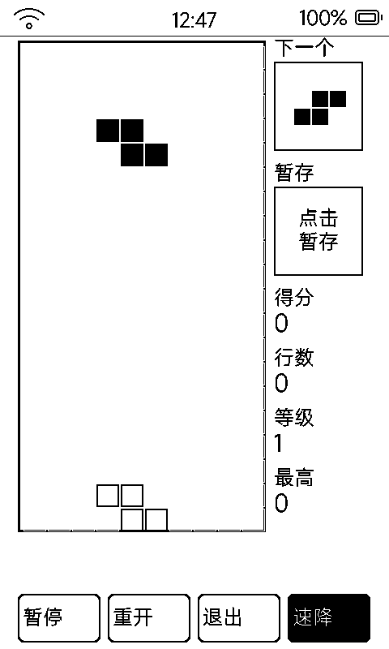

# 时间校准（time）

联网 SNTP 对时 + 手动校准 RTC 的系统工具页。

## 界面

三张卡片：

1. **当前系统时间（RTC）**：56 号大字 HH:MM:SS + 「YYYY 年 MM 月 DD 日 星期 X」+ 对时状态（已完成网络同步 / 正在向 SNTP 同步 / 未联网本地 RTC 运行）+ 上次对时时间
2. **时区配置**：−1 小时 / 默认（UTC+8）/ +1 小时，即时生效
3. **手动校准**：±1 天 / ±1 时 / ±1 分步进，「保存并写入硬件 RTC」

## 操作

- **「立即联网对时 (SNTP)」**黑底按钮即时触发对时（服务器 `ntp.aliyun.com`，默认时区 UTC+8）
- 没有网络也能用：本地 RTC（PCF8563 硬件时钟）继续走，手动校准写入硬件

## 为什么需要它

日历、番茄钟、每日一诗、待机时钟全依赖系统时间；设备长期离线或换时区后，来这里一键校准。PCF8563 硬件 RTC 有纽扣级保持能力，重启不丢时。
