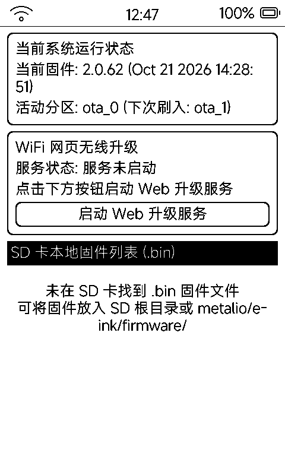

# 系统升级（upgrade）

内置固件升级入口，**双通道**：WiFi 网页无线刷机（OTA）与 SD 卡本地 `.bin` 刷写。

## 当前系统状态

卡片显示：当前固件版本与编译时间、活动分区 / 下次刷入分区（`ota_0` / `ota_1` 双分区轮替，刷坏可回退）。

## 通道一：WiFi 网页无线升级

1. 点「启动 Web 升级服务」——占 80 端口（被占用自动让位）
2. 屏幕给出大号 URL + **200px 二维码**，手机扫码直达
3. 网页选择 `.bin` 上传，流式写入下一个 OTA 分区（校验 ESP32 固件头，非法 bin 拒绝）
4. 全屏进度页显示升级进度，完成后自动重启换到新系统

## 通道二：SD 卡本地升级

- 扫描 SD 的 `metalio/e-ink/firmware/` 与卡根目录下的 `.bin`
- 点固件弹确认窗（项目名 / 目标版本 / 编译时间 / 大小），确认后同样走 OTA 分区刷写
- 支持删除固件文件

## 注意事项

- 升级过程锁闭按键，别断电
- 「合并完整固件」产物见 README「编译与烧录」章节（`./merge_firmware.sh`）
- 远程静默 OTA 还有 HTTP 端点 `POST /system/ota`（见 [`docs/app-store.md`](app-store.md) §8）
