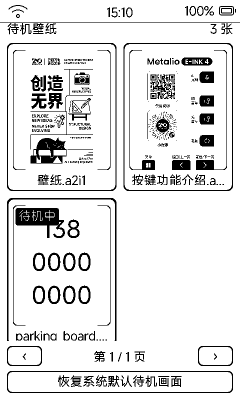

# 待机壁纸（wallpaper）

挑选与设置待机壁纸：把喜欢的图设成待机常显画面，或恢复系统默认。

## 界面与操作

- **网格页**：2×2 大缩略图卡片 + 翻页行 + 整宽「恢复系统默认待机画面」按钮；标题显示「N 张」
- **预览页**：440 宽大图 + 信息行（名称 · 大小 · 使用中 / 未启用）+ 黑底「设为待机壁纸」主按钮
- 盖板 `vk_prev` / `vk_next` 在预览态循环上一张 / 下一张，网格态翻页
- 点卡片进预览；使用中的卡片加粗边框 + 「待机中」黑底徽标

## 图片从哪来

把 PNG / JPG / A2I1 直接放进 SD 的 `/sdcard/metalio/e-ink/wallpaper/` 目录即可（WiFi 传输、虚拟 U 盘、拔卡都行）——放图进目录就是「更新」，无需任何导入动作。

## 配套能力

- 待机壁纸由固件在进待机时解码显示（见 [`app-home.md`](app-home.md) 待机画面）
- 「挪车电话」生成的号码牌也是一种待机壁纸（见 [`app-parking.md`](app-parking.md)）
- 关机画面走同一壁纸库的独立槽位

## 墨水屏上的讲究

图片经 `dynapp_image_decode_l8` 解码为 L8 灰度等比缩放（百毫秒级），缩略图与预览共用一套解码，选图体验不卡顿。
