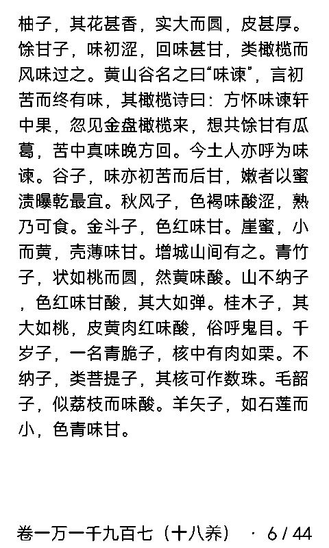
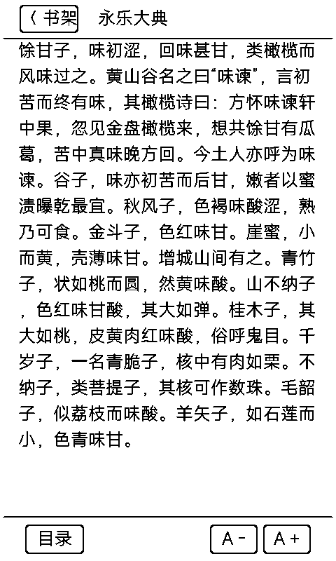

# 微信读书（weread）

基于微信读书 Web 端接口的墨水屏官方生态阅读应用：**微信扫码登录 → 云端书架同步 → 全书目录导航 → 分片解密排版阅读 → 进度双向回传**。

  
  
  

## 它能做什么

- **微信扫码一键登录**：
  - 启动后若未登录自动展示微信官方授权登录二维码。
  - 使用手机微信扫码授权后，设备自动提取并持久化保存 `wr_vid` / `wr_skey` / `wr_rt` 凭据至 NVS，开机自动鉴权免重复扫码。
- **云端个人书架同步**：
  - 实时同步用户在手机端加入书架的书籍，支持数百本藏书管理。
  - 8 宫格分页排版，卡片展示书名、作者与当前阅读百分比，点击书卡秒开阅读。
- **正文分片解密与阅读**：
  - 对齐微信读书官方阅读器接口，自动置换解密加密分片（`e_0` / `e_1` / `e_3` / `t_0` / `t_1`），无需外挂代理或服务器转发。
  - 支持 EPUB 与纯文本书籍自动净化标签格式。
- **480×800 水墨屏流式精致排版**：
  - 针对 3.97″ 墨水屏全宽 428px 自适应折行，单页容纳 17 行高密度中文段落，阅读体验接近纸书。
  - 依据标点符号（`。！？；`）智能断句分页，避免词语被腰斩截断。
  - 正文末行与底部“章节名 · 当前页/总页”保留 120px 充足留白，图层置顶保护，彻底杜绝文字与页脚重叠覆盖。
- **全书目录导航（TOC）**：
  - 随时呼出目录，高亮当前所在章节，点击任意章节瞬时跳转。
  - 目录内存树级缓存，切换章节免反复网络请求。
- **动态字号调节与云端进度同步**：
  - 点击屏幕中央呼出悬浮菜单，提供 `A-` / `A+` 多档字号切换（20px / 24px / 28px），字号变更后自动按视口重新重排整章页码。
  - 退出书籍或翻章时自动调用 `/web/book/read` 上报阅读时长与进度，与手机端微信读书无缝接力。

## 操作指南

- **翻页**：
  - 触摸屏幕右侧区域（$x > 312$）：翻至下一页；在章节末页继续翻页无缝加载下一章。
  - 触摸屏幕左侧区域（$x < 168$）：翻至上一页；在章节首页继续翻页加载上一章。
  - 盖板虚拟键：`vk_next` 下一页，`vk_prev` 上一页。
- **呼出菜单**：
  - 触摸屏幕中央区域（$168 \le x \le 312$）：呼出顶底悬浮控制条。
  - 顶部左上角「`< 书架`」：自动上传进度并返回书架。
  - 底部「`目录`」：进入全书章节目录列表。
  - 底部「`A -`」/「`A +`」：缩小 / 放大字号。
- **返回桌面**：长按盖板 `vk_home` 键 500ms 强制返回系统桌面。

## 技术特性

1. **PSRAM 线程隔离**：所有网络通信、JSON 解析及解密运算统一在 8MB PSRAM 栈工作线程（`SpawnPsrWorker`）中执行，内部 DRAM 零负担，高频切换章节稳定可靠。
2. **纯动态应用架构**：应用以 `.app.zip` 独立打包分发，安装于 SD 卡 `/sdcard/metalio/e-ink/apps/weread.app/`，通过系统动态符号表热加载，更新无需重新烧录完整系统固件。
