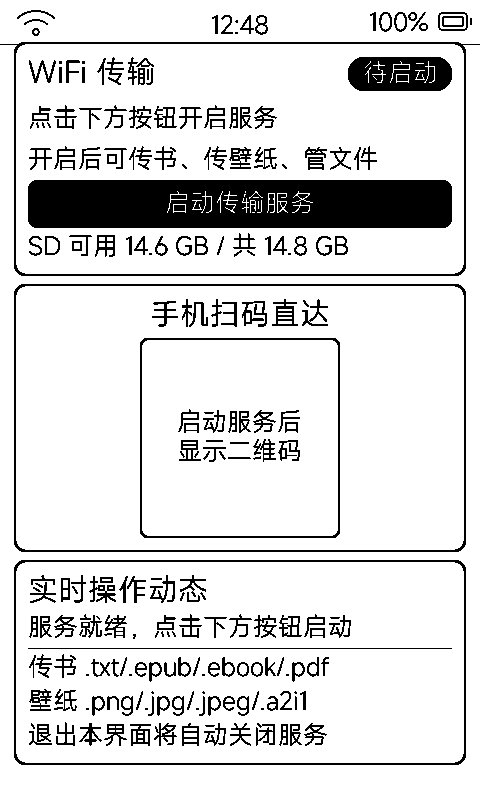

# WiFi 传输（wififile）

局域网网页传书与文件管理：启动服务后，手机 / 电脑浏览器扫码直达，**传书直存图书库**，其余文件全盘管理。

## 界面

| 卡片 | 内容 |
|:---|:---|
| 状态卡 | 服务徽标（未联网 / 待启动 / 运行中）+ 大号 URL + 黑底「启动传输服务」按钮 + SD 容量行 |
| 扫码卡 | 200px 二维码，手机扫码直达网页（地址变化才重绘） |
| 动态卡 | 实时操作日志 + 支持格式说明 |

## 功能

- **传书**：网页上传 `.ebook` / `.epub` / `.txt` 直落 `books/` 并触发书库重扫（设备弹「已收到新书」）
- **传壁纸**：图片文件落 `wallpaper/`，待机壁纸 App 立即可选
- **全盘文件管理**：浏览 / 上传 / 下载 / 删除 / 新建目录，任意 SD 路径
- Web 路由：`/` 页面 + `/api/fs/roots|list|upload|delete|mkdir|download`
- 默认 80 端口，被占用自动回退 8088
- **退出本界面自动关闭服务**，不占后台

## 使用场景

- 没有数据线：手机拍照的图、下载的书，扫码即传
- 批量导入：电脑浏览器拖拽整批书进书库
- 与「应用商店」配合：把 `.app` 包传到 `apps/` 也能完成安装（见 [`docs/app-store.md`](app-store.md)）
