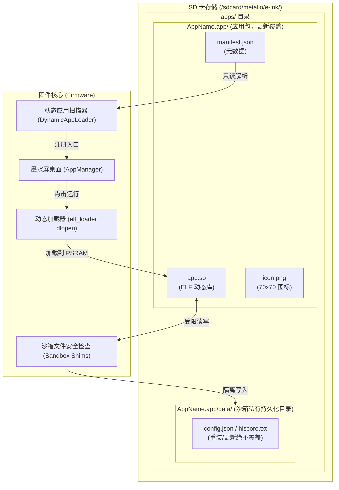

# 动态应用（.app Bundle）开发规范与架构指南

Metalio E-INK 采用借鉴 **macOS / iOS Application Bundle** 的应用包架构与**沙箱存储隔离**机制。应用独立打包、免刷机分发、通过 WiFi / U 盘热加载上屏，实现「一次编译、随处安装、即点即用、退出即卸」。

---

## 1. 核心架构与设计原则



### 1.1 核心特点
1. **免固件刷机（Hot Deploy）**：应用直接存放在 SD 卡上，通过设备常驻的 HTTP MCP 接口（`/fs/upload`）或拔卡/U 盘写入，桌面秒级热刷新，无需重启或重新编译整机固件。
2. **惰性加载（Lazy Loading & Zero Footprint）**：
   - **平时**：仅占数十字节 manifest 内存登记桌面图标，不消耗 PSRAM，不执行任何用户代码。
   - **点开**：`dlopen` 将 `app.so` 载入 PSRAM 并解析固件导出的符号表，创建屏幕。
   - **退出**：返回桌面后屏幕销毁，固件触发 `dlclose`，PSRAM 代码段彻底释放。
3. **数据隔离与重装防覆盖**：
   - 所有的运行时持久化数据、用户配置、游戏存档统一存储在当前应用包内的 `data/` 子目录中。
   - 应用升级或重装时仅覆盖代码与资源，**系统严格保留 `data/` 目录**。
4. **安全沙箱（Security Sandbox）**：
   - 动态应用禁止任意遍历或覆写系统的核心分区、用户电子书或其它应用的数据。
   - 写入严格限制在自己的 `data/` 内；禁止一切 `..` 相对路径穿越。

---

---

## 2. 目录规范与文件职责约束

### 2.1 运行时 Bundle 目录结构与各文件职责

应用部署在设备 SD 卡上的标准路径为 `/sdcard/metalio/e-ink/apps/<AppName>.app/`。整体结构学习了 macOS 的 `.app` Bundle 设计，代码、资源与数据职责清晰划分：

```text
/sdcard/metalio/e-ink/apps/<AppName>.app/
├── manifest.json       [必需 | 只读] 应用元数据描述清单
├── icon.png            [可选 | 只读] 桌面展示图标（70x70 单色 PNG）
├── lib/                [必需 | 只读] 动态共享库目录（强制唯一路径：lib/app.so，不设兼容层）
│   └── app.so          ELF 动态共享库代码段（dlopen 载入）
├── resources/          [可选 | 只读] 应用静态资源包（字体、私有图片、离线字典等）
└── data/               [自动创建 | 可写] 应用唯一的私有持久化目录（沙箱隔离区，重装绝不覆盖）
    ├── config.json     [规范] 用户个性化配置（参数、开关、API Key 等）
    ├── state.json      [规范] 运行时进度、历史记录、游戏最高分
    └── cache/          [可选] 应用本地临时缓存
```

#### 各文件与文件夹的约束与权限说明：

| 文件 / 文件夹 | 权限 | 更新策略 | 职责与使用约束 |
|---|---|---|---|
| `manifest.json` | 固件只读 | 覆盖更新 | 声明应用 ID、展示名称、版本、ABI 闸门与入口动态库路径（`"executable": "lib/app.so"`）。格式必须为标准 JSON。严禁在代码中动态修改此文件。 |
| `icon.png` | 固件只读 | 覆盖更新 | 桌面 70×70 黑白 PNG 图标。若缺失则使用固件内置默认图标。 |
| `lib/` | 固件只读 | 覆盖更新 | **【代码强制存放目录】**。在 Linux/Android 等系统中，`.so` 属于动态共享库（Shared Object），**规范固定且唯一存放于 `lib/app.so`**。固件**不设隐式兼容层**，缺失直接报错拦截。重装升级时直接替换此文件。 |
| `resources/` | 固件只读 | 覆盖更新 | 静态只读资源（如关卡地图、本地离线词典、自定义点阵字模等）。应用仅拥有**读权限**，禁止写入。 |
| `data/` | **应用读写** | **绝不覆盖** | **当前应用专属的沙箱数据目录**。由固件在首次加载时自动创建。**重装、升级应用、OTA 升级时，系统严格保留此目录！** 所有可变状态与配置必须且只能存放于此。 |

---

### 2.2 配置文件存储规范：彻底告别 NVS，全面拥抱文件化

> [!IMPORTANT]
> **【强制约束】动态应用严禁使用 NVS（Non-Volatile Storage）存储业务配置！**

#### 为什么禁止使用 NVS？
1. **容量极端受限**：固件划分给 NVS 的分区仅 16KB，需要支撑整机 Wi-Fi 配网、蓝牙、系统音量、网络对时等底层参数。任何应用滥用 NVS 都会造成全系统存储耗尽崩溃。
2. **缺乏命名空间隔离**：NVS 键名限制在 15 字节以内，多应用极易产生键名冲突。
3. **备份与迁移困难**：NVS 存在于内部 SPI Flash 中，无法通过简单的文件复制进行导出、备份或跨机迁移；设备执行重置（Erase Flash）时配置全丢。
4. **Flash 寿命损耗**：高频更新 NVS 会加快内部 Flash 块擦写磨损。

#### 新规范：基于 `data/` 的文件化配置
- **配置主文件必须位于 `data/config.json`**：应用所有个性化设置（如墨水屏刷新偏好、主题、字号、接口地址、用户 Token、功能开关等）统一采用 JSON 文件保存在 `data/` 目录下。
- **配置持久化保障**：
  - 更新/重装应用时，工具仅上传或替换 `manifest.json`、`icon.png` 与 `lib/app.so`，**`data/` 目录绝不触碰**。
  - 用户配置永不丢失，完美实现无缝热升级。
  - 用户或开发者可随时通过 USB 虚拟磁盘、取出 SD 卡或通过 HTTP `/fs/upload` / `/fs/delete` 直接查看和编辑 `config.json`。

#### 推荐的 `data/config.json` 格式：
```json
{
  "theme": "light",
  "font_size": 24,
  "auto_refresh_interval": 60,
  "sound_effects": false
}
```

---

### 2.3 开发工程源码与构建产物（Git 排除约束）

> [!CAUTION]
> **【构建产物约束】打包出来的产物必须位于工程的 `bin/` 目录下，并严格从 Git 仓库中排除！**
> 严禁将编译出的 `.so`、二进制文件或中间构建产物提交到代码仓库。

在开发仓库中，应用源码与资源遵循以下工程组织形式：

```text
tools/<your_app>/
├── main/
│   ├── <app>_main.c     # [源码] 应用主入口源码（包含 metalio_app_entry）
│   └── ...              # [源码] 其它模块源码与私有头文件
├── manifest.json        # [源码] 清单元数据模板
├── icon.png             # [源码] 应用 70x70 原始图标
├── README.md            # [文档] 应用说明文档
└── bin/                 # 【构建输出产物目录，.gitignore 强排除，绝不进 git】
    └── <app>.app/
        ├── manifest.json
        ├── icon.png
        └── lib/
            └── app.so
```
使用统一构建工具 `./tools/package_app.sh tools/<your_app>` 即可一键完成编译并打包到 `bin/<app>.app/`。

---

### 2.4 manifest.json 字段定义

```json
{
  "id": "fangfang",
  "name": "方方",
  "icon": "icon.png",
  "executable": "app.so",
  "abi": 1,
  "version": "1.0.0"
}
```

| 字段 | 类型 | 必填 | 规范与说明 |
|---|---|---|---|
| `id` | string | 是 | 唯一英文标识（1~12字符，建议全小写字母/数字，如 `hello`, `fangfang`, `reader`）。用于排重与系统内部状态索引。 |
| `name` | string | 是 | 桌面展示名称（支持 UTF-8 中文，如 `"方方"`、`"动态时钟"`）。 |
| `icon` | string | 否 | 图标相对路径，默认为 `"icon.png"`。禁止绝对路径或 `..` 穿越。 |
| `executable`| string | 否 | 动态库文件名，默认为 `"app.so"`（或向下兼容旧版 `<id>.so`）。 |
| `abi` | int | 是 | 必须等于固件当前 `METALIO_DYNAPP_ABI_VERSION`（当前值为 `1`）。若固件大版本升级导致 ABI 变更，不匹配的应用在扫描阶段会被拦截并提示，避免发生崩溃。 |
| `version` | string | 否 | 语义化版本号，如 `"1.0.0"`，在应用商店或设置页展示。 |


---

## 3. C ABI 与沙箱开发 API

动态应用通过包含 `#include "dynamic_app_abi.h"` 与 `#include "dynamic_app_shims.h"` 使用固件开放能力。

### 3.1 沙箱数据与路径 API

> [!IMPORTANT]
> 绝对不要在动态应用中硬编码 `/sdcard/...` 路径，必须统一使用沙箱 API 进行数据读写。

```c
// 1. 安全打开私有数据文件（自动定位至当前应用 bundle 的 data/ 目录下）
//    返回标准 C 库 FILE* 指针，用法同 fopen。
//    严格防穿越：拒绝含 ".."、绝对路径、反斜杠的非法文件名。
void* dynapp_fopen_data(const char* rel_filename, const char* mode);

// 2. 获取当前应用的私有数据目录绝对路径（首次调用若不存在会自动在 SD 卡创建）
//    例如返回："/sdcard/metalio/e-ink/apps/fangfang.app/data"
const char* dynapp_get_data_path(void);

// 3. 获取当前应用 Bundle 根目录绝对路径
//    例如返回："/sdcard/metalio/e-ink/apps/fangfang.app"
const char* dynapp_get_bundle_path(void);

// 4. 沙箱路径合法性检查
//    write=1: 仅允许写入应用自身 data/ 目录；
//    write=0: 允许读取自身 bundle、自身 data、系统字体/壁纸。
int dynapp_is_path_allowed(const char* path, int write);
```

#### 数据读写示例（基础文本与 cJSON 结构化配置）：

**示例 1：读取与更新结构化配置 `data/config.json`（免 NVS）**
```c
#include <cJSON.h>

typedef struct {
    int font_size;
    int auto_refresh;
} app_config_t;

// 读取配置（若文件不存在则赋默认值）
void app_load_config(app_config_t *cfg) {
    cfg->font_size = 24;
    cfg->auto_refresh = 60;

    FILE *fp = (FILE *)dynapp_fopen_data("config.json", "r");
    if (!fp) return;

    fseek(fp, 0, SEEK_END);
    long sz = ftell(fp);
    fseek(fp, 0, SEEK_SET);
    if (sz <= 0 || sz > 16384) { fclose(fp); return; }

    char *buf = (char *)malloc(sz + 1);
    fread(buf, 1, sz, fp);
    buf[sz] = '\0';
    fclose(fp);

    cJSON *root = cJSON_Parse(buf);
    free(buf);
    if (!root) return;

    cJSON *item = cJSON_GetObjectItemCaseSensitive(root, "font_size");
    if (cJSON_IsNumber(item)) cfg->font_size = item->valueint;

    item = cJSON_GetObjectItemCaseSensitive(root, "auto_refresh");
    if (cJSON_IsNumber(item)) cfg->auto_refresh = item->valueint;

    cJSON_Delete(root);
}

// 保存配置
void app_save_config(const app_config_t *cfg) {
    cJSON *root = cJSON_CreateObject();
    cJSON_AddNumberToObject(root, "font_size", cfg->font_size);
    cJSON_AddNumberToObject(root, "auto_refresh", cfg->auto_refresh);

    char *json_str = cJSON_PrintUnformatted(root);
    cJSON_Delete(root);
    if (!json_str) return;

    FILE *fp = (FILE *)dynapp_fopen_data("config.json", "w");
    if (fp) {
        fputs(json_str, fp);
        fclose(fp);
    }
    free(json_str);
}
```

**示例 2：纯文本简单读写（如游戏最高分、计数器）**
```c
// 保存最高分
FILE *fp = (FILE *)dynapp_fopen_data("hiscore.txt", "w");
if (fp != NULL) {
    fprintf(fp, "%d\n", high_score);
    fclose(fp);
}

// 读取最高分
FILE *fp = (FILE *)dynapp_fopen_data("hiscore.txt", "r");
if (fp != NULL) {
    fscanf(fp, "%d", &high_score);
    fclose(fp);
}
```

### 3.2 系统与 UI 桥接 API

```c
// 1. 在屏幕顶部自动挂接系统状态栏（显示时钟、电量图标、Wi-Fi 图标）
void* dynapp_screen_status_bar(void* scr);

// 2. 挂接页面虚拟键：
//    name: 虚拟键组标识
//    factory: 重建界面的函数指针
//    on_key: 虚拟键回调函数（esp_timer 上下文，仅允许做状态更新或投递异步）
void dynapp_vk_attach(void* scr, const char* name,
                      void* (*factory)(void), int (*on_key)(const char* key));

// 3. 一键安全返回桌面
void dynapp_screen_go_home(void);

// 4. 线程安全投递 LVGL 异步任务（非 LVGL 线程更新 UI 必备）
int dynapp_lv_async(void (*cb)(void*), void* user_data);

// 5. 获取全字重矢量点阵字库（大字体桥）
//    size: 字号（如 18, 24, 28, 30 等），weight: 0=常规, 2=粗体
const lv_font_t* fontpack_lv_font_get(uint16_t size, uint8_t weight);
```

---

## 4. 应用代码框架与开发范式

标准应用采用纯 C 语言编写，以下是官方规范模板（可直接参考 [`tools/hello_app/main/hello_main.c`](file:///Users/weibh/Desktop/Metalio-E-INK4/tools/hello_app/main/hello_main.c)）：

```c
#include <stdio.h>
#include <stdlib.h>
#include <string.h>

#include "lvgl.h"
#include "dynamic_app_abi.h"
#include "dynamic_app_shims.h"
#include "fontpack_lvgl.h"

static void *my_app_create(void);

// 1. 虚拟键处理回调（例如响应 HOME 键与返回键）
static int my_app_on_key(const char *key) {
    if (key == NULL) return 0;
    if (strcmp(key, "home") == 0 || strcmp(key, "prev") == 0) {
        dynapp_screen_go_home();  // 返回系统桌面
        return 1;
    }
    return 0;
}

// 2. 屏幕销毁清理回调（退出应用时必须清理所有自建资源！）
static void my_app_screen_delete_cb(lv_event_t *e) {
    // 【重要】若有通过 lv_timer_create 或 esp_timer 创建的定时器，必须在此 delete！
    // 退出应用后 .so 代码段会被释放，遗留的定时器回调会导致野指针崩溃。
}

// 3. 创建应用主屏幕
static void *my_app_create(void) {
    lv_obj_t *scr = lv_obj_create(NULL);
    lv_obj_set_style_bg_color(scr, lv_color_white(), 0);
    lv_obj_set_style_bg_opa(scr, LV_OPA_COVER, 0);
    lv_obj_add_event_cb(scr, my_app_screen_delete_cb, LV_EVENT_DELETE, NULL);

    // 挂接系统状态栏与虚拟按键
    dynapp_screen_status_bar(scr);
    dynapp_vk_attach(scr, "myapp", my_app_create, my_app_on_key);

    // 从沙箱 data/ 目录加载持久化数据
    int launch_count = 0;
    FILE *fp = (FILE *)dynapp_fopen_data("launch_count.txt", "r");
    if (fp) { fscanf(fp, "%d", &launch_count); fclose(fp); }
    launch_count++;
    fp = (FILE *)dynapp_fopen_data("launch_count.txt", "w");
    if (fp) { fprintf(fp, "%d\n", launch_count); fclose(fp); }

    // 渲染 UI 控件
    lv_obj_t *label = lv_label_create(scr);
    lv_label_set_text_fmt(label, "运行次数: %d", launch_count);
    const lv_font_t *font = fontpack_lv_font_get(28, 2);
    if (font) lv_obj_set_style_text_font(label, font, 0);
    lv_obj_center(label);

    return scr;
}

// 4. 动态应用唯一入口函数（固定命名，供固件 dlsym 查找）
void metalio_app_entry(metalio_app_desc_t *out) {
    out->abi_version = METALIO_DYNAPP_ABI_VERSION;
    out->id = "myapp";
    out->name = "我的应用";
    out->icon = "icon.png";
    out->create = my_app_create;
}
```

---

## 5. 一键构建、打包与部署工具（`package_app.sh`）

项目提供了统一的打包与部署工具 [`tools/package_app.sh`](file:///Users/weibh/Desktop/Metalio-E-INK4/tools/package_app.sh)。

### 5.1 仅在本地编译打包
```bash
# 自动编译 tools/hello_app/main/hello_main.c 并输出 tools/hello_app/pkg/hello.app/
./tools/package_app.sh tools/hello_app
```

### 5.2 编译并通过 WiFi 一键推送至真机
在连接同局域网 Wi-Fi 下，设备开启 Local MCP 服务，可直接一键部署（热重载，桌面立即可见）：
```bash
./tools/package_app.sh tools/hello_app --upload 192.168.0.84 --pin 444108
```
> [!TIP]
> 设备的 IP 地址与 MCP PIN 码可在开机 USB 串口日志中查看到，也可在设备的「系统设置」界面中查看。

---

## 6. HTTP API 文件直传接口

除了打包脚本外，外部系统或 AI 代理可以直接通过标准的 HTTP REST 端点进行应用分发与管理：

### 6.1 上传文件到应用 Bundle
```bash
curl -X POST "http://<设备IP>:8080/fs/upload?path=apps/<AppName>.app" \
  -H "X-Filename: app.so" \
  -H "Authorization: Bearer <PIN>" \
  --data-binary @path/to/app.so
```
*推送到 `apps/<AppName>.app/` 目录时，系统会自动触发增量扫描与桌面注册，无需重启。*

### 6.2 删除或卸载应用
```bash
curl -X POST "http://<设备IP>:8080/fs/delete?path=apps/<AppName>.app" \
  -H "Authorization: Bearer <PIN>"
```
*自动删除应用文件并在桌面注销该应用入口。*

---

## 7. 符号表能力面与扩展

动态应用只能调用固件通过 `g_metalio_dynapp_syms` 符号表显式导出的 API。

### 7.1 当前可用能力面
1. **LVGL 9 核心图形接口**：
   - 基础对象：`lv_obj_*`（创建、样式、对齐、坐标、父子树、删除等）
   - 常用组件：`lv_label_*`, `lv_button_*`, `lv_img_*`, `lv_canvas_*`, `lv_line_*`, `lv_table_*` 等
   - 颜色与动画：`lv_color_*`, `lv_anim_*`
2. **C 标准库（libc）**：
   - 内存分配：`malloc`, `free`, `calloc`, `realloc`
   - 字符串与内存：`strlen`, `strcmp`, `strcpy`, `memset`, `memcpy` 等
   - 格式化输出：`printf`, `snprintf`, `sprintf`
   - 数学库：`sin`, `cos`, `sqrt`, `rand`, `srand` 等
3. **Metalio 专用桥接**：
   - `dynapp_fopen_data`, `dynapp_get_data_path`, `dynapp_get_bundle_path`
   - `dynapp_screen_status_bar`, `dynapp_vk_attach`, `dynapp_screen_go_home`
   - `fontpack_lv_font_get`

### 7.2 如果缺少某个符号怎么办？
1. 查看串口输出：如果动态应用引用了未导出的符号，`dlopen` 会在终端打印 `dlerror: symbol 'xxx' not found`。
2. 在固件 [`main/services/dynamic_apps/dynamic_app_loader.cc`](file:///Users/weibh/Desktop/Metalio-E-INK4/main/services/dynamic_apps/dynamic_app_loader.cc) 的 `g_metalio_dynapp_syms` 中加入对应的函数指针条目，重新编译固件即可永久开放该能力。

---

## 8. 参考示例工程

| 示例工程 | 路径 | 特性展示 |
|---|---|---|
| **Hello App** | [`tools/hello_app/`](file:///Users/weibh/Desktop/Metalio-E-INK4/tools/hello_app/) | 最小规范模板：Bundle 结构、状态栏、虚拟键、沙箱持久化计数器 |
| **方方 (FangFang)** | [`tools/fangfang_app/`](file:///Users/weibh/Desktop/Metalio-E-INK4/tools/fangfang_app/) | 完整游戏：方块消除算法、墨水屏局部刷新优化、虚拟键按键控制、沙箱最高分排行榜 |
