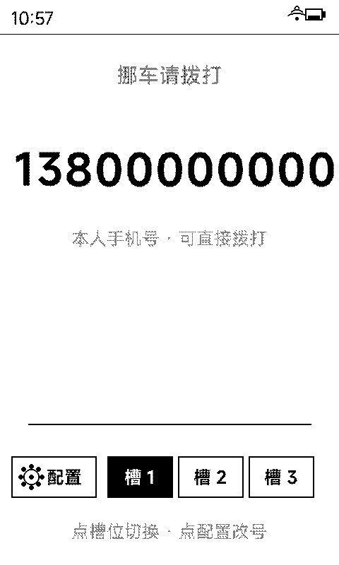
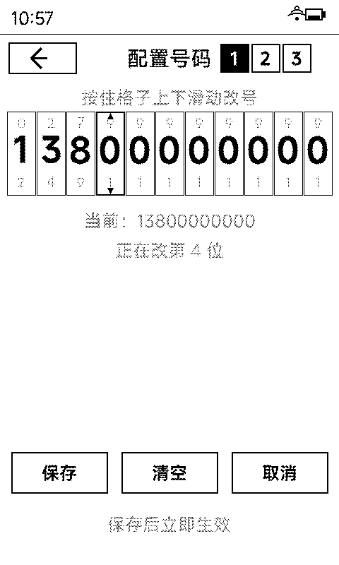

# 挪车电话显示 App · PRD

| 项目 | 内容 |
| --- | --- |
| 应用名（桌面显示） | **挪车电话** |
| 应用 ID | `parkphone` |
| 形态 | 动态应用 `.app`（免刷机，WiFi 热装，即装即用） |
| 目标设备 | Metalio E-Ink 4：3.97 寸 **480×800**、1bpp 黑白墨水屏、CST816S 电容触摸 |
| 代码目录 | `tools/parkphone_app/` |
| 文档状态 | **v0.1 待评审** —— 评审通过后进入开发 |
| 效果图 | `docs/mockups/parkphone-main.png`、`docs/mockups/parkphone-config.png`（480×800 真机比例 1bit 渲染） |

---

## 0. 一页速览

给一块墨水屏（贴在车窗/车头/车位挡风玻璃内侧），把「我的挪车电话」用**特大号数字**常驻显示，
旁边留一个 **⚙ 配置**按钮和 **3 个预设槽位**：

- **显示页**：屏幕正中一行 11 位大数字（如 `13800000000`），下方一行小字说明；底部一条操作栏
  ——`[⚙ 配置] [槽1] [槽2] [槽3]`，点哪个槽位就立刻显示哪一组号码。
- **配置页**：点 ⚙ 进入，**11 个格子横排**，每个格子一位数字；**按住格子上下滑动即可改这一位**，
  松手即定；底下 `保存 / 清空 / 取消`。保存后立刻回显示页，显示新号码。
- 三组号码互不干扰，存本地 `data/config.json`，重装 App 不丢。

> 本期不做的：二维码、TTS 朗读、槽位改名、号码分组显示、自动切换。见 §13。

---

## 1. 背景与问题

车停好了，挡风玻璃上留个号码是刚需。手机上存个联系人很容易，但**路人要看**：

- 手机要解锁、要翻通讯录、要找到「挪车那个」，耗时长、失败率高；
- 纸质纸条会丢、会淋雨、会看不清；
- 车机/中控屏不能随便占。

墨水屏的独占优势：**熄屏待机几乎不耗电**（只显示不刷新就零耗电）、**阳光下可读**、**一天到晚挂着不变**。
一块 480×800 的屏挂在前挡风玻璃里，把号码做成特大号，一眼可见、伸手就够。

但墨水屏是 1bpp、刷新慢、没有动画，所以这个 App 的设计必须围绕两个硬约束：
**①数字必须足够大（远处一眼看清）②滚动改号必须有手感（墨水屏不跟手）**。

---

## 2. 目标 / 非目标

### 目标

1. **看得清**：11 位号码横排铺满屏宽，数字墨高 ≥ 44px，1 米外可读。
2. **改得动**：不用键盘、不用拨号盘，在 11 个格子上滑动就能改号，全程 ≤ 20 秒改完一个号。
3. **切得快**：3 组号码一键切换（家人 / 同事 / 备用），点槽位即刻生效。
4. **不丢数**：数据存沙箱 `data/`，App 重装/升级不覆盖；异常退出不写坏文件。
5. **不打扰**：常态零刷新、零动画、零网络请求（纯本地、纯离线）。

### 非目标（本期明确不做）

- 整屏旋转 / 真横屏 UI（见 §13 Q1）
- 扫码输入、电话簿同步、云端备份
- 二维码、TTS 朗读、闹钟/定时切换、槽位自定义标签
- 多于 3 个槽位、号码分组显示（`138 0000 0000`）

---

## 3. 用户与场景

| 角色 | 场景 | 期望 |
| --- | --- | --- |
| 车主（主要） | 停车后在车窗留牌 | 把号码配好，然后一键切到「本人」组长期挂着 |
| 路人 | 看到号码要打电话 | 3 米外能看清、记住，拨号盘直接输 |
| 家人/同事 | 临时需要联系我 | 车主切一下槽位，家人看到的是自己认得的号码 |

---

## 4. 平台约束（先读，决定了后面所有设计）

| 约束 | 事实 | 对设计的影响 |
| --- | --- | --- |
| 屏幕 | 480×800，**1bpp 黑白**，竖屏 | 只能靠**尺寸 + 黑白反差**做层级；灰阶靠抖动 |
| 刷新 | 局刷可用，但有延迟（~0.3~1s）；固件每 N 次局刷自动全刷一次 | **禁动画**；改动尽量只脏一小块区域；离开/保存时手动全刷一次清残影 |
| 触摸 | CST816S，15ms 轮询，逻辑坐标与屏幕一致 | 拖动判定自己做（位移阈值 6px 区分「点」与「滑」） |
| 虚拟键 | 盖板物理键：`vk_prev` / `vk_next` / `vk_home` / `esc` / `back` | 显示页：左右键切槽位；配置页：上下键改当前位；`esc` 返回 |
| 字包 | 设备字包只有 **25@2 / 30@2 / 30@4 / 18,28,36@2**（MiSans + Math） | 现有最大数字墨高仅 ~25px，**直接用字包做不出大号数字** → §9.1 |
| 字包分区 | `font_data` 分区 5MB，当前字包 5,240,941 B，**只剩 ~1.9KB** | 没法往整机字包里塞新字号（除非裁字或扩分区）→ 数字改走应用内嵌 |
| SDK | 动态应用 = 纯 C + LVGL v9 子集；数据必须落 `data/`（`dynapp_fopen_data`）；**无 NVS** | 配置用 `data/config.json` + cJSON |
| 导出符号 | `lv_roller_create` 未导出（`lv_roller_class/set_options/set_selected` 在） | 数字滚轮**不能直接用 lv_roller**，要自己实现（§9.3） |

---

## 5. 信息架构与页面流转

```
                 ┌──────────────────────────┐
   桌面图标 ───► │      显示页 (Main)        │
                 │  大号码 + [配置][槽1-3]   │
                 └────┬──────────┬──────────┘
       点 ⚙ 配置     │          │  点 槽1/2/3
                      ▼          └────────► 原地切换号码（局刷）
                 ┌──────────────────────────┐
                 │      配置页 (Config)      │
                 │  11 格横排 · 上下滑动改位 │
                 │  [保存] [清空] [取消]      │
                 └───┬──────────┬───────────┘
              保存 │          │ 取消/返回/ESC
                     ▼          ▼
                 写 config.json → 回显示页（号码=新值，全刷一次）
```

两页都在同一个 LVGL 屏幕内切换（销毁当前 screen → 建新 screen），沿用仓库现有动态应用范式
（参考 `tools/weather_app/main/weather_main.c` 的 `factory` + `dynapp_vk_attach`）。

---

## 6. 界面设计

坐标系：全屏 480×800，原点左上。状态栏由固件 `dynapp_screen_status_bar()` 生成，**高 48px**，
内容区从 y=52 起。

### 6.1 显示页（Main）



```
┌────────────────────────────────────────┐ y=0
│ 10:57                        📶 🔋      │  状态栏（固件生成，高 48）
├────────────────────────────────────────┤ y=48
│                                        │
│              挪 车 请 拨 打             │  y=100  居中，30px，50% 灰
│                                        │
│   1 6 6 0 1 1 0 3 6 1 8                 │  y=215  ★ 主体：11 位横排
│                                        │        数字墨高 46px，整行 x=20..460
│        本人手机号 · 可直接拨打            │  y=325  25px，45% 灰
│                                        │
│                                        │
│  ──────────────────────────────────    │  y=600  1px 分隔线 x=40..440
│                                        │
│  ┌──────────┐ ┌──────┐┌──────┐┌──────┐│  y=646  按钮高 58
│  │ ⚙ 配置    │ │ 槽 1 ││ 槽 2 ││ 槽 3 ││
│  └──────────┘ └──────┘└──────┘└──────┘│
│         点槽位切换 · 点配置改号           │  y=740  25px，45% 灰
└────────────────────────────────────────┘ y=800
```

**尺寸表**

| 元素 | 位置/尺寸 | 样式 |
| --- | --- | --- |
| 标题「挪车请拨打」 | 居中，基线区 y=100..134 | MiSans Medium 30px，50% 灰 |
| 号码行 | x=20..460，y=215..261 | 自定义大号字体（见 §9.1），纯黑，字符间距自动均分 |
| 副提示 | 居中 y=325..357 | 25px，45% 灰 |
| 分隔线 | y=600，x=40..440 | 1px 实线 |
| ⚙ 配置按钮 | x=16..136, y=646..704 | 2px 圆角描边 + 齿轮图标 |
| 槽位按钮 ×3 | x=152/252/352, 宽 92, y=646..704 | 2px 描边；**当前槽位 = 黑底白字（反白）** |
| 底部说明 | 居中 y=740 | 25px，45% 灰 |

**规则**

- 号码行**必须**是屏幕上最黑的元素（纯黑，无抖动），保证远距离可读。
- 3 个槽位按钮**始终都存在**（不隐藏空槽位）；空槽位文字改为「槽 2 · 空」并保持白底。
- 当前槽位在**数据变更后仍保持高亮**，退出 App 再进入也记得上次显示的是哪一组（`current_slot` 落盘）。
- 未设置号码时：号码位置显示「— 未设置 —」（30px 灰），副提示改为「点 ⚙ 配置填上号码」。

### 6.2 配置页（Config）



```
┌────────────────────────────────────────┐ y=0
│ 10:57                        📶 🔋      │
├────────────────────────────────────────┤ y=48
│ ┌────────┐     配 置 号 码    ┌─┐┌─┐┌─┐│  y=60..104
│ │   ←    │                     │1││2││3││  槽位切换 chip 40×40
│ └────────┘                     └─┘└─┘└─┘│  当前槽位反白
│                                        │
│          按住格子上下滑动改号            │  y=126  25px，45% 灰
│  ┌─┐┌─┐┌─┐┌─┐┌─┐┌─┐┌─┐┌─┐┌─┐┌─┐┌─┐ │  y=158  11 格
│  │9││5││5││9││0││0││9││2││5││0││7│ │  格宽 40，间距 2，左边距 10
│  │1││6││6││0││1││1││0││3││6││1││8│ │  格高 118
│  │2││7││7││1││2││2││1││4││7││2││9│ │  大数字墨高 ~38px 居中
│  └─┘└─┘└─┘└─┘└─┘└─┘└─┘└─┘└─┘└─┘└─┘ │  上下为「幽灵邻位」（20px 25% 灰）
│                                        │
│            当前：13800000000            │  y=300  25px，50% 灰
│             正在改第 4 位               │  y=342  25px，45% 灰
│                                        │
│  ┌──────────┐  ┌────────┐  ┌────────┐ │
│  │   保存    │  │  清空   │  │  取消   │ │  y=640..698
│  └──────────┘  └────────┘  └────────┘ │
│             保存后立即生效               │  y=730
└────────────────────────────────────────┘
```

**尺寸表**

| 元素 | 位置/尺寸 | 样式 |
| --- | --- | --- |
| 返回按钮 | x=12..108, y=60..104 | 2px 描边 + ← 箭头 |
| 标题「配置号码」 | 居中 y=60..104 | Medium 30px，纯黑 |
| 槽位 chip ×3 | x=312/356/400, 40×40, y=62..102 | 2px 描边；当前反白 |
| 操作提示 | 居中 y=126 | 25px，45% 灰 |
| **11 个数字格** | x=10 + i×42（宽 40），y=158..276 | 未选中：1px 细框；**选中：2px 粗框 + 上下实心三角** |
| 格内大数字 | 居中，墨高 ~38px | 纯黑 |
| 幽灵邻位 | 格内上/下，20px | 25% 灰（选中的格子不显示幽灵，改显 ▲▼） |
| 号码预览 | 居中 y=300 | 25px，50% 灰（快速核对整体） |
| 当前位提示 | 居中 y=342 | 25px，45% 灰 |
| 保存/清空/取消 | x=16/172/328，宽 136，y=640..698 | 2px 描边 |
| 保存说明 | 居中 y=730 | 25px，45% 灰 |

**规则**

- 进入配置页时，默认选中**第 1 位**（也可用虚拟键左右移动）。
- 格子总数恒为 11，**不允许增删**（中国手机号固定 11 位）。
- 「清空」= 把当前槽位号码置空（不是清掉整个 App 的数据），需二次确认（Toast 提示 + 再点一次确认，或弹确认条）。
- 「取消」/ 返回 / ESC = 放弃本次修改，回到显示页，**不写盘**。
- 「保存」= 写入 `data/config.json` → 回显示页 → **触发一次全刷**清残影 → Toast「已保存」。

### 6.3 空态与异常态

| 状态 | 表现 |
| --- | --- |
| 某槽位未设置 | 显示页该槽位显示「— 未设置 —」；点它的配置按钮可编辑该槽位（保存后即生效） |
| 全部未设置 | 显示页数字区显示「— 未设置 —」，副提示「点 ⚙ 配置填上号码」 |
| `config.json` 损坏 / 解析失败 | 回落默认（3 个空槽位）+ Toast「配置已重置」，不崩溃、不白屏 |
| 号码含非法字符 | 保存时只保留数字字符，非法字符丢弃并 Toast 提示一次 |
| 号码长度 < 11 | 保存时高位补 0 存为 11 位；显示时去掉前导 0 |

---

## 7. 交互细则：滚动改号（核心）

### 7.1 手势定义

| 阶段 | 判定 | 行为 |
| --- | --- | --- |
| 按下 | 命中某个格子 | 该格进入**选中态**（粗框 + ▲▼），其余格不变 |
| 拖动 | 纵向位移累计 Δy | 上滑（Δy < 0）数字 **+1**，下滑（Δy > 0）数字 **-1**；**每 36px 走 1 位** |
| 松手 | — | 停在该位；该格做一次局刷；释放手势 |
| 点击（位移 < 6px） | — | 仅选中该格，**不改数字**（防误触） |

- **循环**：9 再上滑 → 0；0 再下滑 → 9（默认开，可在配置里关；本期 UI 不暴露开关，写进 `settings.wrap_digits`）
- **多格同时响应**：不允许。同一时刻只有被按住的格子响应手势。
- **一次只改一位**：手指横向滑动超过 20px 视为「误触/放弃」，不产生数字变化。

### 7.2 墨水屏手感的补偿（关键）

局刷有延迟，如果「滑动时实时跳位」，手指会跑在屏幕前面（迟滞感）。两种模式：

| 模式 | 行为 | 取舍 |
| --- | --- | --- |
| **A. 实时跳位**（默认） | 滑动中每跨过 36px 就把该格数字改掉，脏区只有该格 → 单格局刷 | 跟手但略迟滞；改 1 位只需 1 次局刷 |
| **B. 松手跳位** | 滑动中只显示「预览数字」（大字随手指变），松手才真正提交并局刷 | 屏幕几乎不刷新、最省电；但滑动过程中预览字变化也要局刷，其实省不了多少 |

**结论：默认 A**（实现简单、行为可预期）。若真机实测迟滞难受，再切 B 作为可选项。

### 7.3 快捷操作

| 输入 | 显示页 | 配置页 |
| --- | --- | --- |
| 触摸 | 点槽位切换；点 ⚙ 进配置 | 点格子选中；上下滑改数 |
| `vk_prev` / `vk_next` | 切上一个/下一个槽位 | 当前位 −1 / +1（不用手滑的备选路径） |
| `vk_home` | 回桌面 | 回桌面（不写盘） |
| `esc` / `back` | 回桌面 | 回显示页（放弃修改） |

> 虚拟键回调运行在 esp_timer 上下文，**只允许改状态 + 投递**（`dynapp_lv_async`），不能直接动 LVGL 对象。

---

## 8. 数据模型与持久化

文件：`apps/parkphone.app/data/config.json`（用 `dynapp_fopen_data("config.json", ...)` 读写）

```json
{
  "schema": 1,
  "current_slot": 0,
  "slots": [
    { "digits": "13800000000", "label": "", "updated_at": "2026-10-24T12:00:00" },
    { "digits": "",           "label": "", "updated_at": "" },
    { "digits": "",           "label": "", "updated_at": "" }
  ],
  "settings": {
    "wrap_digits": true,
    "show_hint": true
  }
}
```

| 字段 | 规则 |
| --- | --- |
| `schema` | 版本号，未来结构变化时用于迁移；读不到或版本更高 → 回落默认 |
| `current_slot` | 0..2，记忆上次显示的槽位 |
| `slots` | **长度固定 3**；读到的数组不足 3 个 → 补空；多余 → 忽略 |
| `slots[i].digits` | 11 位数字字符串；空串 = 未设置；读取时剔除非数字字符 |
| `slots[i].label` | 预留字段（v2 用），本期恒为空 |
| `settings.wrap_digits` | 数字是否 0↔9 循环，默认 true |

**写入策略**

- 只在「保存」时写盘，**不做自动保存**（避免拖动过程频繁写 SD）。
- 写文件顺序：写临时文件 → `fclose` → 覆盖 `config.json`（或直接 truncate 写，风险：写一半掉电会坏文件）。
  → **决策**：直接 truncate 写，但读失败时回落默认（不崩）+ Toast 提示，够用；不引入双文件机制（本期）。
- 退出 App（`LV_EVENT_DELETE`）时**不写盘**（内存里的草稿丢弃）。

---

## 9. 关键技术决策

### 9.1 大号数字怎么画（最关键的一条）

现有字包最大数字只有 30@4（墨高 25px），11 位排开仅 209px 宽，**占屏宽 44%**，远看不够；
且整机 `font_data` 分区只剩 1.9KB，**塞不进新字号**。

| 方案 | 做法 | 优点 | 缺点 | 结论 |
| --- | --- | --- | --- | --- |
| **A. 应用内嵌位图 + 自定义 LVGL 字体** | 构建期用 Python 从 MiSans-Semibold 渲染 0–9（62px），生成 1bpp 位图数组编进 `.so`；运行时注册一个 `lv_font_t`（自写 `get_glyph_dsc` / `get_glyph_bitmap` 回调） | 字号自由、只增 4–8KB ROM、随 App 热更新、不动固件与整机字包、纯黑白最清晰 | 要写 ~80 行生成脚本 + 自定义字体回调；与固件 LVGL 版本耦合（用 SDK 头文件编译即可） | ✅ **采用** |
| B. 整机字包加 60@2 数字 | 给 `font_data` 分区补新字号 | 全 App 都能用大号数字 | 分区只剩 1.9KB → 要么裁现有汉字（影响别的 App），要么改分区表并重刷固件 | ❌ 本期不做，留作 v2 全局优化 |
| C. 用 30@4 数字 + LVGL transform 放大 | 直接对 label 做 2× 缩放 | 零改动 | 1bpp 放大后边缘锯齿明显，且 `transform` 在固件导出符号里没有 | ❌ |

> 备选兜底：若自定义字体在真机上出问题，退回 B 之前的最小可行版——用字包 30@4 排一行（数字偏小，但功能完整）。

### 9.2 墨水屏刷新策略

| 场景 | 做法 |
| --- | --- |
| 滚动改号 | 只把该格标脏 → 单格局刷；**不做动画**（`LV_ANIM_OFF`），滚动条/淡入淡出一律不用 |
| 切换槽位 | 只脏号码区 + 底栏按钮区 |
| 进入/退出配置页 | 整页重绘 |
| 保存后回显示页 | 调 `dynapp_epd_full_refresh()` 一次，全刷清残影 |
| 长时间挂机 | 不做任何定时刷新（零刷新 = 零耗电） |

### 9.3 触摸与手势实现

- 不用 `lv_roller`（`lv_roller_create` 未导出到 SDK）。做法：每格是一个**透明可点击容器**，
  内部 1 个大数字 label + 2 个幽灵 label；容器上挂 `LV_EVENT_PRESSED`（记录起点）、
  `LV_EVENT_PRESSING`（累计位移 → 改数字）、`LV_EVENT_RELEASED`（收尾）。
- 格子对象**必须清掉 `LV_OBJ_FLAG_SCROLLABLE`**，否则 LVGL 自己的滚动手势会抢走事件。
- 固件 `lv_indev_set_scroll_limit(indev, 6)`，与本 App 自管手势不冲突，但注意 LVGL 可能同时发
  `LV_EVENT_SCROLL`——忽略它即可。

### 9.4 资源与内存

| 项 | 估算 |
| --- | --- |
| 数字位图（10 个字形，62px，1bpp） | ≈ 10 × 36×46/8 ≈ **2.1KB**（存 `.rodata`，不占堆） |
| 运行时堆占用 | 配置页约 11 个容器 + 33 个 label ≈ **< 20KB**（LVGL 对象在 PSRAM） |
| 网络 | **零**（全本地，不碰 HTTPS，规避 14KB 连续 RAM 的坑） |
| 磁盘 | `data/config.json` < 1KB |

---

## 10. 实现计划

### 10.1 文件清单

```
tools/parkphone_app/
├── main/
│   └── parkphone_main.c      # 应用主体（显示页 + 配置页 + 手势 + 存取）
│   └── park_digits.h         # [生成物] 0-9 大号位图（由脚本产出，提交进仓库）
├── tools/
│   └── make_digits.py        # 构建期脚本：MiSans → 1bpp 位图 → park_digits.h
├── manifest.json             # id=parkphone, name=挪车电话, abi=1
├── icon.png                  # 70×70 桌面图标
└── README.md                 # 使用与配置说明

docs/prd-parking-phone-display.md   # 本文档
docs/mockups/parkphone-*.png        # 效果图
```

### 10.2 里程碑

| 阶段 | 内容 | 产出/验收 |
| --- | --- | --- |
| **M0** | PRD 评审（本文件 + 效果图） | 需求确认，§13 问题拍板 |
| **M1** | 骨架：manifest + 图标 + 显示页静态版 | 真机截图：号码横排正确、底栏布局对 |
| **M2** | 槽位切换 + 数据读写（config.json） | 3 组号码存取、切换、重启记忆 |
| **M3** | 配置页：11 格渲染 + 上下滑改号 + 保存/清空/取消 | 改号全流程跑通 |
| **M4** | 大号数字：生成脚本 + 自定义 LVGL 字体接入 | 数字墨高 ≥ 44px，铺满屏宽 |
| **M5** | 墨水屏手感调优（灵敏度、局刷范围、全刷时机） | 连续改 11 位不卡、不残影 |
| **M6** | 打包分发（`.app.zip`）+ README + 真机验收 | §11 清单全绿 |

### 10.3 构建与部署

```bash
./tools/package_app.sh tools/parkphone_app                        # 本地编译打包
./tools/package_app.sh tools/parkphone_app --upload <设备IP> --pin <PIN>   # 热装到真机
```

---

## 11. 验收标准（真机逐条打勾）

| # | 验收项 | 通过条件 |
| --- | --- | --- |
| 1 | 桌面图标 | 桌面出现「挪车电话」，可点开，无崩溃 |
| 2 | 显示页排版 | 状态栏正常；号码 11 位横排、无重叠无裁切；数字墨高 ≥ 44px |
| 3 | 槽位切换 | 点槽 1/2/3 立即换号码；当前槽位反白高亮 |
| 4 | 配置进入 | 点 ⚙ 进入配置页，11 格内容与当前号码一致；当前槽位高亮 |
| 5 | 滚动改号 | 任意格上下滑只改该位；点一下不误改；松手数值稳定 |
| 6 | 边界 | 0 上滑 → 9；9 下滑 → 0（循环开）；一次只响应一个格子 |
| 7 | 保存 | 保存后回显示页显示新号码；**退出 App 重进仍是新号码** |
| 8 | 清空 | 清空后显示「— 未设置 —」，仍可再配置 |
| 9 | 取消 | 取消后号码不变（不写盘） |
| 10 | 多槽位 | 三组号码互不干扰，分别保存/切换正确 |
| 11 | 记忆 | 重开 App 记住上次显示的槽位 |
| 12 | 健壮性 | config.json 损坏 → 回落默认 + Toast，不白屏不崩 |
| 13 | 墨水屏观感 | 改号时无整屏闪烁；保存后全刷残影消失；连续操作 20 次无残影条纹堆积 |
| 14 | 稳定 | 连续快速切槽位 20 次、改号 50 次不崩溃、无内存泄漏（`dynapp_sysinfo_get` 看 ram_free 稳定） |
| 15 | 离线 | 全程无网络请求；飞行模式下功能完整 |

---

## 12. 风险与对策

| 风险 | 概率 | 影响 | 对策 |
| --- | --- | --- | --- |
| 墨水屏局刷迟滞，滑动跟手性差 | 高 | 中 | 灵敏度可调（36px/位）；备选「松手跳位」模式；必要时用虚拟键上下改 |
| 自定义字体与固件 LVGL ABI 不匹配 | 中 | 高 | 用 `sdk/include/lvgl` 头文件编译；M4 阶段真机验证；失败则退回字包 30@4 兜底版 |
| 大数字位图 ROM 占用超预期 | 低 | 低 | 1bpp 下 10 字形 ≈ 2KB；必要时降到 54px 重生成 |
| 11 位手输效率低（改一个号要滑十几次） | 中 | 中 | 整串复制粘贴（v2）；本期靠「幽灵邻位 + 预览行」降低误操作 |
| 配置文件写坏 | 低 | 中 | 写前校验 + 读失败回落默认；本期不做双文件原子写 |
| 设备长期挂机耗电 | 低 | 低 | 常态零刷新；不做定时刷新 |

---

## 13. 待确认问题（评审时拍板）

| # | 问题 | 我的建议 |
| --- | --- | --- |
| **Q1** | **「横屏显示」指哪一种？** ① 号码横着排成一行（本 PRD 默认）；② 整个界面旋转 90°，设备横放时 UI 跟着转 | 选 ①。设备物理是 3.97″ 竖屏，固件无旋转支持；真要 ② 得改固件（显示旋转 + 触摸坐标重映射），约 1 人日 + 全机重刷，收益有限 |
| **Q2** | 数字要多大？当前方案墨高 46px，11 位刚好铺满 460px | 先按 46px 做（M4 真机看效果再调）；再大就得缩间距或减少边距 |
| **Q3** | 3 个槽位要不要名字（如「本人 / 家人 / 同事」）？ | 本期留 `label` 字段不显示；v2 加，编辑页加一行小字输入 |
| **Q4** | 要不要顺带做**二维码**（扫一下就能拨号/加好友）或 **TTS 朗读**？ | 都留到 v2，本期先把「显示 + 改号」做扎实 |
| **Q5** | 空槽位是否保留占位？ | 保留（3 个槽位恒显示），符合「点哪个显示哪一组」的预期 |
| **Q6** | 号码要不要分组显示（`138 0000 0000`）？ | 本期不分组；统一间距更整齐，也避免路人误读 |

---

## 14. 附录

### 14.1 按键映射总表

| 键 | 显示页 | 配置页 |
| --- | --- | --- |
| `vk_prev` | 上一个槽位 | 当前位 −1 |
| `vk_next` | 下一个槽位 | 当前位 +1 |
| `vk_home` | 回桌面 | 回桌面（不写盘） |
| `esc` / `back` | 回桌面 | 回显示页（放弃修改） |
| 触摸 | 点槽位切换 / 点 ⚙ 进配置 | 点格子选中 / 上下滑改数 |

### 14.2 术语

- **槽位（slot）**：3 组号码中的一组，`slots[0..2]` ↔ 界面「槽 1/2/3」。
- **格子（cell）**：配置页里的一位数字，11 格 = 11 位号码。
- **局刷 / 全刷**：墨水屏的局部刷新 / 整屏刷新（全刷能消残影但慢、耗电）。
- **幽灵邻位**：格子里上下淡显的相邻数字，提示「这里能滚」。
