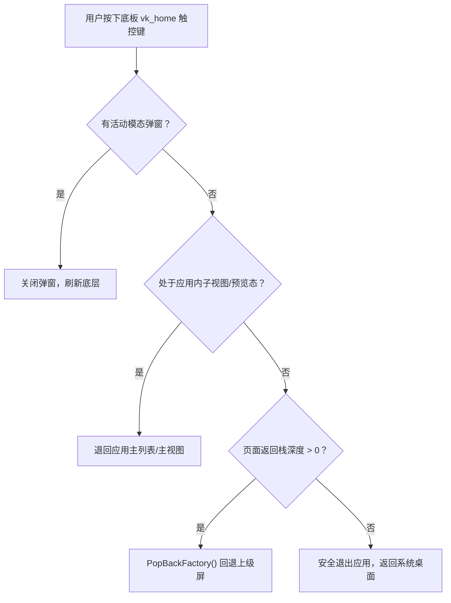

# Metalio E-INK 系统特性、升级、调试与截屏完整指南

本文档全面汇总了 Metalio E-INK 墨水屏设备截至目前的核心系统特性、固件与应用更新升级方式、多维度调试排错手段，以及截屏获取与 90 度正向旋转标准。

---

## 一、 系统全貌与核心特性

### 1.1 硬件与显示架构
- **主控芯片**：ESP32-S3（双核 Xtensa LX7，支持 2.4GHz Wi-Fi + BLE 5）。
- **显示面板**：4.2 英寸电子墨水屏（E-INK），分辨率 **480 × 800**（竖屏视角）。
- **驱动控制**：SSD1677 控制器，支持局部快速刷新（局刷，A2 模式）与深度全局刷新（全刷，清除残影）。
- **灰阶算法**：采用 Bayer 抖动算法实现流畅的 16 阶灰度图片与插图渲染。
- **触控与按键**：电容触摸屏，底部配有独立的触控虚拟按键 **`vk_home`**。

### 1.2 统一按键导航规范（纯净全屏设计）
1. **统一由 `vk_home` 接管全局返回**：
   - 设备底部的专用触控虚拟键 `vk_home` 是全局唯一的标准返回键。
   - 分层回退机制：
     - 若当前有活动的模态弹窗（确认对话框 / 提示浮层），优先关闭顶层弹窗。
     - 若处于二级视图（例如壁纸单张预览），退回主视图（壁纸列表）。
     - 若处于页面返回栈子级，退回上一级页面。
     - 若在应用根界面，直接安全退出应用并平滑返回系统桌面。
     - 在系统桌面首页时，`vk_home` 处于静默防误触状态（No-op）。
   - **长按 `vk_home`**：在任意深度页面均可一键强制直达系统桌面。
2. **彻底移除所有应用中的「‹ 返回」顶栏**：
   - 彻底去除应用顶部的 56px 返回 Header 行，将纵向视口高度全额（750px）还给核心功能与图文展示。



### 1.3 内置核心系统应用
在系统桌面（Home Screen）中，核心功能已作为永久内置屏注册（不受 SD 卡插拔影响）：
1. **电源管理（PowerScreen）**：
   - 提供「息屏待机」、「重启系统」、「关机」三大核心动作。
   - 关机具备二次确认防误触模态弹窗，关机后彻底切断输出保护电池。
2. **系统设置（SettingsScreen）**：
   - Tab 驱动架构：Wi-Fi 网络、主题排版、触控反馈、蓝牙、自动化服务、关于本机。
3. **系统升级（SystemUpgradeScreen）**：
   - 固件信息看板（当前版本、运行分区、目标刷写分区）。
   - WiFi 局域网 Web 无线刷机服务（扫码或浏览器一键刷入）。
   - SD 卡离线固件自动检索与无电脑一键刷写。
4. **应用商店（AppStoreScreen）**：
   - 本地 SD 卡 `.app` 动态应用包扫描与管理。
5. **电子书阅读器（BookScreen）**：
   - 支持 EPUB / TXT 多格式书籍，多字体动态切换，书签与阅读进度掉电持久化。
6. **AI 语音助手（AiVoiceChatScreen）**：
   - 结合 MiniMax STT/TTS 与流式大模型，内嵌 Local MCP 工具调用能力。

### 1.4 动态应用生态（.app Bundle 规范）
- **Bundle 结构**：借鉴 macOS/iOS Application Bundle 设计：
  ```text
  AppName.app/
  ├── manifest.json    # 应用元数据（名称、版本、入口符号）
  ├── app.so           # 动态链接库（ELF 格式，仅用固件导出符号表）
  ├── icon.png         # 70×70 单色透明图标
  └── data/            # 沙箱私有持久化目录（应用升级重装严格保留）
  ```
- **惰性加载与零内存占用**：平日仅占用数十字节 Manifest 元数据，用户点开时才 `dlopen` 载入 PSRAM，退出即 `dlclose` 并彻底释放代码段内存。

---

## 二、 固件与应用更新升级指南

系统支持 **4 种固件升级方式** 与 **1 种动态应用热更新方式**，覆盖有线、无线、局域网静默、脱机 SD 卡等所有场景。

### 2.1 方式一：WiFi Web 网页无线升级（最直观）
适用于日常使用或手机微信/浏览器操作：
1. 在设备桌面上点击打开 **「系统升级」** 应用。
2. 点击卡片中的 **「启动 Web 升级服务」** 按钮（启动端口 80 的 HTTP 服务）。
3. 用手机/电脑在同一局域网下访问界面提示的 URL：`http://<device_ip>/`。
4. 在网页中点击选择编译生成的 `build/xiaozhi.bin`，点击升级。
5. **或者直接在终端通过 curl 一键推流**：
   ```bash
   curl -X POST --data-binary @build/xiaozhi.bin http://<device_ip>/upload_ota
   ```
6. 设备墨水屏上会实时刷新进度条与传输速率，写入 100% 校验通过后，设备将在 1.5 秒内自动重启进入新固件。

### 2.2 方式二：Local MCP 静默远程 OTA（自动化最佳）
适用于开发调试、CI/CD 自动化流水线或 AI Agent 无物理接触式刷机：
- 设备常驻 8080 端口，无需在设备屏幕上手动开启 Web 服务：
```bash
curl -X POST http://<device_ip>:8080/system/ota \
     -H "Authorization: Bearer <PIN>" \
     --data-binary @build/xiaozhi.bin
```
> **提示**：静默刷机完成后，设备会自动切换引导分区至 `next_partition` 并重启。

### 2.3 方式三：SD 卡离线脱机固件升级（无网络与电脑环境）
1. 将任意合法的 ESP32 固件镜像（`.bin` 文件）拷贝至 SD 卡中：
   - 路径 A（推荐）：`/sdcard/metalio/e-ink/firmware/*.bin`
   - 路径 B（根目录）：`/sdcard/*.bin`
2. 打开设备上的 **「系统升级」** 界面。
3. 下方「SD 卡本地固件列表」会自动扫描并列出检测到的镜像，显示文件名、大小与编译时间。
4. 点击目标固件，弹出升级确认弹窗，确认后直接在后台读取 SD 卡块并刷写 Flash，全程无需联网。

### 2.4 方式四：USB-C 有线线刷（底层救砖与出厂量产）
使用 USB-C 数据线连接电脑与设备的 USB 端口：
```bash
# 激活 ESP-IDF 环境后编译并烧录
. $HOME/esp/esp-idf/export.sh
idf.py -p /dev/cu.usbmodem* flash
```

### 2.5 动态应用（.app）无线热部署（无需重启整机）
针对 `tools/` 目录下的各个动态应用，无需重新编译整个固件，即可直接将单个应用部署至设备：
```bash
# 语法：./tools/package_app.sh <app_dir> --upload <device_ip> --pin <pin>
./tools/package_app.sh tools/radio_app --upload 192.168.0.84 --pin 444108
./tools/package_app.sh tools/glm_app --upload 192.168.0.84 --pin 444108
```
设备会完成热解包并触发桌面重载，新图标即刻可见。

---

## 三、 系统调试与运维排错指南

### 3.1 局域网 UDP 无线实时 Syslog（推荐，免接线）
设备固件启动后，会自动将所有 `ESP_LOG` 日志通过 UDP 组播/单播推送到局域网 **5140** 端口。电脑端无需连接串口即可查看实时动态：
```bash
# 在终端中运行 UDP 监听器
python3 -u -c "
import socket
sock = socket.socket(socket.AF_INET, socket.SOCK_DGRAM)
sock.bind(('0.0.0.0', 5140))
print('正在监听设备日志 (UDP 5140)...')
while True:
    data, addr = sock.recvfrom(4096)
    print(data.decode('utf-8', errors='replace'), end='')
"
```

### 3.2 局域网 REST 自动化控制端点（端口 8080）
所有接口均支持 HTTP Bearer PIN 码认证：`Authorization: Bearer 444108`。

| 目标动作 | HTTP 请求与参数 | 说明 |
| :--- | :--- | :--- |
| **设备探活** | `GET http://<ip>:8080/health` | 无需认证，返回 JSON 系统运行健康状态 |
| **设备安全重启** | `POST http://<ip>:8080/system/reboot` | 触发后台独立任务 1 秒后重启设备 |
| **强制返回桌面** | `POST http://<ip>:8080/screen/home` | 无论处于何种界面/卡死界面，立即返回桌面 |
| **启动指定应用** | `POST http://<ip>:8080/app/launch?id=power` | 启动 `power`、`upgrade`、`store`、`radio` 等 |
| **注入虚拟按键** | `POST http://<ip>:8080/input/key?key=vk_home` | 注入 `vk_home`、`vk_prev`、`vk_next` 触控事件 |
| **全局深刷屏幕** | `POST http://<ip>:8080/screen/refresh` | 触发全刷，清除墨水屏残影 |
| **SD 卡文件列表** | `GET http://<ip>:8080/fs/list?path=firmware` | 浏览 SD 卡指定目录下的文件与目录 |
| **SD 卡文件下载** | `GET http://<ip>:8080/fs/download?path=...` | 从设备中拉取日志、存档或配置文件 |
| **SD 卡文件删除** | `POST http://<ip>:8080/fs/delete?path=...` | 删除指定文件 |

### 3.3 USB 串口调试监视器
```bash
idf.py -p /dev/cu.usbmodem* monitor
```

---

## 四、 远程截屏与画面 90 度旋转规范

### 4.1 核心原理与旋转必要性
> [!IMPORTANT]
> **关于截屏方向的重要说明**：
> 1. **驱动硬件拓扑**：SSD1677 电子墨水屏控制器在物理硅片和显存排布上为 **800 × 480**（横向驱动）。
> 2. **LVGL 软件旋转**：系统软件配置将逻辑视口旋转为 **480 × 800** 竖屏以符合用户手持方式。
> 3. **底层显存镜像**：由 `/screen/screenshot` 导出的原生 1bpp 单色 BMP 是原始显存物理数据（800 × 480）。
> 4. **显示校准规则**：因此，获取到的原始截屏图像**必须顺时针旋转 90 度（Rotate 90° Clockwise）**，才能得到宽高为 **480 × 800**、与用户手持设备完全一致的正向操作界面！

### 4.2 一键截屏脚本（已内置正向旋转）
工程已提供开箱即用脚本 [`tools/screenshot.sh`](file:///Users/weibh/Desktop/Metalio-E-INK4/tools/screenshot.sh)：
```bash
# 抓取当前屏幕并自动顺时针旋转 90 度输出为正向 480x800 图片
./tools/screenshot.sh /tmp/my_screen.png

# 指定设备 IP 与 PIN 码
./tools/screenshot.sh /tmp/device_view.bmp --ip 192.168.0.84 --pin 444108
```

### 4.3 命令行手动获取与校准
若需在自己的脚本或流水线中手动操作：
```bash
# 1. 下载原始数据 (800x480)
curl -s -H "Authorization: Bearer 444108" http://192.168.0.84:8080/screen/screenshot -o /tmp/raw.bmp

# 2. 顺时针旋转 90 度校准为竖屏 (480x800)
# 方法 A：macOS 自带原生 sips 工具（超高速）
sips -r 90 /tmp/raw.bmp --out /tmp/screen_upright.bmp

# 方法 B：Python PIL / Pillow
python3 -c "from PIL import Image; Image.open('/tmp/raw.bmp').transpose(Image.ROTATE_270).save('/tmp/screen_upright.bmp')"

# 方法 C：ImageMagick
convert /tmp/raw.bmp -rotate 90 /tmp/screen_upright.bmp
```

### 4.4 截屏效果对比示例
- **原始底层显存（横向逆时针）**：800 × 480 像素，阅读文字为横置。
- **顺时针旋转 90 度后（正向竖屏）**：480 × 800 像素，顶部为状态栏（Wi-Fi、电量、时钟），主体为 3×3 桌面宫格或应用卡片，底部为页码原点，与眼睛所见真机完全一致。

---

## 五、 工程常用工具集（Tools Index）

| 脚本路径 | 核心功能与使用说明 |
| :--- | :--- |
| [`tools/screenshot.sh`](file:///Users/weibh/Desktop/Metalio-E-INK4/tools/screenshot.sh) | 远程截取墨水屏画面，自动顺时针旋转 90 度输出正向 480×800 图像 |
| [`tools/package_app.sh`](file:///Users/weibh/Desktop/Metalio-E-INK4/tools/package_app.sh) | 动态应用（.app）构建打包、生成 `manifest.json` 与一键 WiFi 热部署 |
| [`tools/fontpack/`](file:///Users/weibh/Desktop/Metalio-E-INK4/tools/fontpack/) | 预渲染字库生成器，打包点阵字体包与 mmap 零拷贝加载 |
| [`tools/ebook/`](file:///Users/weibh/Desktop/Metalio-E-INK4/tools/ebook/) | 电子书离线解析预处理引擎，生成目录、段落缓存与 A2I1 封面 |

---

## 六、 全量 MCP 工具与 REST 自动化接口清单

设备支持两套自动化调用体系：
1. **Model Context Protocol (MCP)**：标准 JSON-RPC 规范（通过 `/mcp` 端点或大模型 Function Calling 直接调度）。
2. **RESTful HTTP API**：直接供 cURL、外部脚本、Home Assistant 或自动化控制台调用的轻量接口。

### 6.1 全量 MCP 工具清单 (Tools for AI Agents)

#### A. 设备硬件与系统基础 (`self.*`)
| MCP 工具名称 | 参数 | 说明 |
| :--- | :--- | :--- |
| `self.get_device_status` | 无 | 获取扬声器音量、屏幕、电池电压与百分比、网络等实时硬件状态 |
| `self.get_system_info` | 无 | 获取芯片信息、固件版本、运行时间、内存利用率等详细信息 |
| `self.audio_speaker.set_volume` | `volume: int (0-100)` | 调节板载扬声器音量 |
| `self.screen.set_brightness` | `brightness: int (0-100)` | 调节背光亮度（若硬件支持） |
| `self.screen.get_info` | 无 | 查询屏幕宽度、高度、单色标识 |
| `self.screen.refresh` | 无 | 触发墨水屏全局深度刷新，消除残影 |
| `self.screen.go_home` | 无 | 强制退出当前所有子界面，平滑回到系统桌面 |
| `self.reboot` | 无 | 立即安全重启设备 |
| `self.power_off` | 无 | 完全关机，切断电源输出 |
| `self.sleep` | 无 | 进入待机息屏低功耗模式 |
| `self.upgrade_firmware` | `url: string` | 从指定网络 URL 下载并烧录固件，自动重启 |
| `self.apps.launch` | `id: string` | 根据应用 ID 拉起界面（如 `power`、`radio`、`book`、`store`、`upgrade` 等） |
| `self.input.key` | `key: string` | 注入虚拟按键事件（如 `vk_home`、`vk_prev`、`vk_next`、`boot`） |
| `self.input.click` | `x: int, y: int, duration_ms?: int` | 模拟屏幕物理触控点击，触发完整 LVGL 命中测试、按压视觉反馈、马达震动与点击回调 |
| `self.fs.save_file` | 无 | 文件直传指引工具，指导 AI 通过 curl 极速上传二进制至 SD 卡 |

#### B. 日历日程 (`self.calendar.*`)
| MCP 工具名称 | 参数 | 说明 |
| :--- | :--- | :--- |
| `self.calendar.add_event` | `date: string, time: string, title: string` | 在指定日期（YYYY-MM-DD）添加日程安排 |
| `self.calendar.add_event_today` | `time: string, title: string` | 快速在今日添加日程 |
| `self.calendar.list_events` | `date: string` | 查询指定日期的所有日程清单 |
| `self.calendar.today` | 无 | 获取今天的全部日程安排 |
| `self.calendar.remove_date` | `date: string` | 清空指定日期的所有日程 |
| `self.calendar.clear` | 无 | 清空全部日历数据 |
| `self.calendar.subscribe_ics` | `url: string` | 订阅远程 iCalendar (.ics) 日历源 |
| `self.calendar.unsubscribe_ics` | 无 | 取消外部 iCalendar 日历订阅 |
| `self.calendar.refresh_ics` | 无 | 强制拉取并同步远程 iCal 日历 |
| `self.calendar.ics_status` | 无 | 查询 iCal 订阅同步状态与最后更新时间 |

#### C. 网络收音机 (`self.radio.*`)
| MCP 工具名称 | 参数 | 说明 |
| :--- | :--- | :--- |
| `self.radio.play_index` | `index: int` | 按电台序号播放 |
| `self.radio.play_name` | `name: string` | 按电台名称匹配并播放 |
| `self.radio.next` | 无 | 切换到下一个电台 |
| `self.radio.prev` | 无 | 切换到上一个电台 |
| `self.radio.random` | 无 | 随机选择一个电台播放 |
| `self.radio.stop` | 无 | 停止音频流播放 |
| `self.radio.set_volume` | `volume: int (0-100)` | 调节播放音量 |
| `self.radio.get_state` | 无 | 查询收音机运行状态、当前电台、缓冲状态 |
| `self.radio.list` | `page: int, count: int` | 分页列出电台清单（内置 300+ 电台与外部自定义） |
| `self.radio.search` | `keyword: string` | 搜索电台 |
| `self.radio.fav_list` | 无 | 获取收藏电台列表 |
| `self.radio.fav_play` | `index: int` | 播放收藏夹中的电台 |
| `self.radio.fav_add` | `name: string, url: string` | 添加电台到收藏夹 |
| `self.radio.fav_remove` | `name: string` | 从收藏夹移除电台 |

#### D. GLM 用量监控 (`self.glm_usage.*`)
| MCP 工具名称 | 参数 | 说明 |
| :--- | :--- | :--- |
| `self.glm_usage.configure` | `token: string` | 配置智谱 GLM 平台 API Key 或用户 Token |
| `self.glm_usage.get_config` | 无 | 查询配置状态与脱敏 Key |
| `self.glm_usage.get_usage` | 无 | 查询 5 小时窗口用量、每周用量及配额进度条 |
| `self.glm_usage.refresh` | 无 | 强制从 GLM 服务端拉取最新用量数据 |

#### E. 动态应用包管理 (`self.app.*`)
| MCP 工具名称 | 参数 | 说明 |
| :--- | :--- | :--- |
| `self.app.list` | 无 | 列出 SD 卡上所有已安装及可用的 .app 动态应用 Bundle |
| `self.app.get_info` | `id: string` | 查询指定动态应用的元数据、版本与描述 |
| `self.app.install` | `id: string` | 将指定的 .app Bundle 注册并显示在系统桌面 |
| `self.app.uninstall` | `id: string` | 从桌面卸载应用（严格保留其 `data/` 用户数据） |
| `self.app.enable` | `id: string` | 启用应用 |
| `self.app.disable` | `id: string` | 禁用应用 |

#### F. 电子书与云书库 (`self.book.*`)
| MCP 工具名称 | 参数 | 说明 |
| :--- | :--- | :--- |
| `self.book.save_text_book` | `filename: string, content: string` | 将纯文本小说直接写入 SD 卡 `/sdcard/books/` |
| `self.book.download_book` | `url: string, filename: string` | 从网络 URL 异步下载电子书文件到本地 |
| `self.book.list_books` | 无 | 列出本地书库中的全部书籍及大小 |
| `self.book.delete_book` | `filename: string` | 删除指定书籍文件 |

#### G. 系统 NVS 配置备份与恢复 (`self.backup.*`)
| MCP 工具名称 | 参数 | 说明 |
| :--- | :--- | :--- |
| `self.backup.create` | `name: string` | 导出当前 WiFi、设置、音量等 NVS 到 SD 卡备份包 |
| `self.backup.list` | 无 | 查看 SD 卡已存储的全部历史备份清单 |
| `self.backup.restore` | `name: string` | 从备份归档恢复系统配置 |
| `self.backup.delete` | `name: string` | 删除历史备份文件 |

#### H. 无线远程 Syslog 日志 (`self.syslog.*`)
| MCP 工具名称 | 参数 | 说明 |
| :--- | :--- | :--- |
| `self.syslog.configure` | `host: string, port: int` | 配置日志上报目标 UDP 主机与端口 |
| `self.syslog.enable` | `enabled: bool` | 开启或关闭无线 Syslog 实时推流 |
| `self.syslog.status` | 无 | 查看 Syslog 推流运行状态与累计报文统计 |

#### I. AI 语音助手与对话控制 (`self.aichat.*`)
| MCP 工具名称 | 参数 | 说明 |
| :--- | :--- | :--- |
| `self.aichat.configure` | `api_key: string, model: string, ...` | 配置对话大模型与 MiniMax 音频参数 |
| `self.aichat.clear_history` | 无 | 清空上下文对话历史 |
| `self.aichat.status` | 无 | 查询音频管线、录音状态与 WebSocket 握手状态 |

---

### 6.2 RESTful HTTP 自动化接口全量清单 (Port 8080 & Port 80)

所有 8080 端口接口均要求在请求头中附带 PIN 码：`Authorization: Bearer 444108`。

#### A. 设备控制与自动化端点 (Port 8080)
| 路径 | 方法 | 请求体 / Query 参数 | 响应格式 | 核心行为说明 |
| :--- | :--- | :--- | :--- | :--- |
| `/mcp` | `POST` | JSON-RPC 2.0 请求体 | JSON | 标准 MCP 协议网关，直接执行上述 40+ 个 MCP 工具 |
| `/health` | `GET` | 无 | JSON | 系统探活接口，无需认证，返回健康心跳 |
| `/screen/screenshot` | `GET` | 无 | `image/bmp` | 截取全屏 1bpp 单色 BMP（需顺时针旋转 90 度为竖屏） |
| `/screen/capture.bmp` | `GET` | 无 | `image/bmp` | 同上，别名端点 |
| `/screen/refresh` | `POST` | 无 | JSON | 触发墨水屏全局深度全刷，清除物理残影 |
| `/screen/home` | `POST` | 无 | JSON | 强制安全回到桌面，退出当前运行中的应用 |
| `/app/launch` | `POST` | `?id=<app_id>` | JSON | 启动指定应用（如 `power`、`upgrade`、`radio` 等） |
| `/input/key` | `POST` | `?key=<key_name>` | JSON | 注入硬件触控键（`vk_home`、`vk_prev`、`vk_next`） |
| `/input/click` | `POST` / `GET` | `?x=<0..479>&y=<0..799>&duration_ms=<ms>` 或 JSON Body | JSON | 模拟真实手指点击屏幕或盖板按键，触发完整 LVGL 命中测试、按压视觉态与马达震动 |
| `/system/reboot` | `POST` | 无 | JSON | 独立后台任务 1 秒后重启设备 |
| `/system/sleep` | `POST` | 无 | JSON | 触发设备进入低功耗息屏待机 |
| `/sleep` | `POST` | 无 | JSON | 同上，简便别名 |
| `/system/ota` | `POST` | 二进制 Body (`xiaozhi.bin`) | JSON | 静默接收固件流、写入 OTA 分区、切换引导并重启 |
| `/fs/list` | `GET` | `?path=<relative_dir>` | JSON | 枚举 `/sdcard/metalio/e-ink` 下目录与文件 |
| `/fs/download` | `GET` | `?path=<relative_file>` | 二进制流 | 从 SD 卡下载文件到本地 |
| `/fs/upload` | `POST` | `?path=<dir>`, Header `X-Filename` | JSON | 极速将二进制文件直传保存到 SD 卡目录（限 2MB） |
| `/fs/delete` | `POST` | `?path=<relative_path>` | JSON | 删除 SD 卡上的指定文件或空目录 |

#### B. 固件在线升级端点 (Port 80)
由 `SystemUpgradeScreen` 启动的 Web 刷机服务专属端口：
| 路径 | 方法 | 说明 |
| :--- | :--- | :--- |
| `/` | `GET` | 手机与电脑浏览器直访的现代化 OTA 刷机前端页面 |
| `/api/upgrade_info` | `GET` | 获取当前固件版本、运行分区（如 `ota_1`）与目标分区（如 `ota_0`） |
| `/upload_ota` | `POST` | 固件流上传通道（支持浏览器表单或 curl `--data-binary`），带真机墨水屏进度条与自动重启 |

