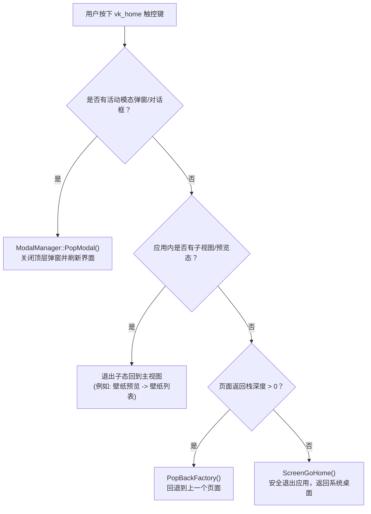

# Metalio E-INK 统一按键导航与自动化控制规范

本文档记录了系统的统一按键导航设计规范、内置电源管理核心应用以及完整的局域网自动化控制接口。

---

## 1. 统一按键导航规范（Unified Navigation Specification）

### 1.1 设计背景与核心原则
在墨水屏设备（480×800 竖屏）有限的显示区域中，顶部额外包裹包含「‹ 返回」或「＜」按钮的 Header 行占用了 52~56 像素的高度，造成了竖向视口空间的浪费。

设备底部拥有专用的触控虚拟键：**`vk_home`**。
根据全局交互设计原则：
1. **触控 `vk_home` 键就是全局返回键**：控制所有层级的返回动作，逐级回退，直至返回到桌面。
2. **彻底去掉所有应用中的返回顶栏行**：无论是系统内置界面还是动态应用（.app Bundle），均不再套用「‹ 返回」顶栏，将完整的屏幕垂直高度全额返还给核心功能与内容区域。
3. **分层回退（Hierarchical Back Stack）**：
   - 当屏幕上有活动模态弹窗（Modal Dialog / Alert / Menu）时：优先消费并关闭顶层模态。
   - 当页面处于子视图（如壁纸预览、设置子页）时：回退到上一级视图或主列表。
   - 当页面处于应用根界面时：直接返回系统桌面（Home Screen）。
   - 在系统桌面首页时：`vk_home` 处于静默空操作（No-op），避免闪屏。
4. **长按 `vk_home` 快捷回桌面**：无论在任何应用深层页面，长按 `vk_home` 均可一键直达系统桌面。



### 1.2 改造清单
已彻底移除返回顶栏并适配 `vk_home` 统一导航的组件与应用包括：
- **系统内置屏**：
  - `power_screen`：内置电源管理屏，完全移除 Header，按钮自状态栏下方舒适居中排列。
  - `system_upgrade_screen`：系统升级页，禁用 Header 返回键，专注展示固件信息与 Web 升级服务。
  - `app_store_screen`：应用商店页，禁用 Header 返回键，列表占满全屏。
  - `ai_voice_chat_screen`：语音对话页，禁用 Header 返回键。
- **动态应用（.app Bundle）**：
  - `radio_app`（网络收音机）：移除 Header，播放控制卡片与电台滚动列表整体上移，视口高度扩展至 750px。
  - `glm_app`（GLM 用量查询）：移除 Header，刷新按钮整合至内容顶部操作行。
  - `info_app`（系统与硬件信息）：移除 Header，刷新按钮整合至顶部操作栏。
  - `time_app`（时间与网络对时）：移除 Header，直接以系统时钟卡片开篇。
  - `cal_app`（日历）：移除 Header，使用内置的月份与翻页控制栏。
  - `backup_app`（备份与恢复）：移除 Header，弹窗状态下 `vk_home` 优先关闭弹窗，二次按下退回桌面。
  - `transfer_app`（WiFi 传书）：移除 Header，卡片直连状态栏。
  - `wififile_app`（WiFi 文件管理）：移除 Header。
  - `wallpaper_app`（壁纸设置）：移除 Header，单张壁纸预览模式下 `vk_home` 返回壁纸列表，列表中 `vk_home` 返回桌面。
  - `power_app`（电源管理）：同步移除 Header。

---

## 2. 内置电源管理核心应用（Built-in PowerScreen）

电源管理已从可选动态应用提升为**固件内置核心应用**：
- **源码位置**：[`main/display/screen/power_screen/power_screen.cc`](file:///Users/weibh/Desktop/Metalio-E-INK4/main/display/screen/power_screen/power_screen.cc)
- **注册机制**：在 `AppManager` 中注册为强制核心应用（`IsMandatory() == true`），永久驻留桌面，绝不受 SD 卡热插拔或重载影响。
- **三大核心动作**：
  1. **息屏待机**：调用 `PowerPolicy::GetInstance().RequestStandby()` 进入低功耗待机模式，显示待机壁纸。
  2. **重启系统**：调用 `PowerPolicy::GetInstance().RequestReboot()` 优雅同步落盘并触发硬件重启。
  3. **关机**：弹出双重确认模态弹窗，确认后切断电源芯片输出，保护电池。

---

## 3. 全局自动化控制接口（Local MCP / Automation API）

系统内置常驻的 HTTP 自动化控制端点（端口 **8080**），所有接口通过 HTTP Bearer 认证（PIN 码）：

### 3.1 认证方式
```http
Authorization: Bearer <PIN>
```

### 3.2 接口总览

| 路径 | 方法 | 说明 | 参数 / 请求体 |
| :--- | :--- | :--- | :--- |
| `/health` | `GET` | 探活与系统状态 | 无需认证，返回 JSON 健康状态 |
| `/screen/screenshot` | `GET` | 墨水屏全屏截图 | 返回 480×800 1bpp 标准 BMP 图片 |
| `/screen/refresh` | `POST` | 触发墨水屏全局深刷 | 无 |
| `/screen/home` | `POST` | 强制返回桌面 | 无 |
| `/app/launch` | `POST` | 打开指定应用 | `?id=<app_id>` (如 `power`, `radio`, `glm`) |
| `/input/key` | `POST` | 注入虚拟按键事件 | `?key=vk_home` / `vk_prev` / `vk_next` |
| `/system/reboot` | `POST` | 独立任务异步重启设备 | 立即返回 JSON，并在 1 秒后重启 |
| `/system/sleep` | `POST` | 触发设备进入待机 | 无 |
| `/system/ota` | `POST` | 静默刷入新固件并自动重启 | 二进制 Body 为完整固件文件 (`xiaozhi.bin`) |
| `/fs/list` | `GET` | 列出 SD 卡应用目录文件 | `?path=<relative_path>` |
| `/fs/download` | `GET` | 下载 SD 卡文件 | `?path=<relative_path>` |
| `/fs/delete` | `POST` | 删除 SD 卡文件 | `?path=<relative_path>` |
